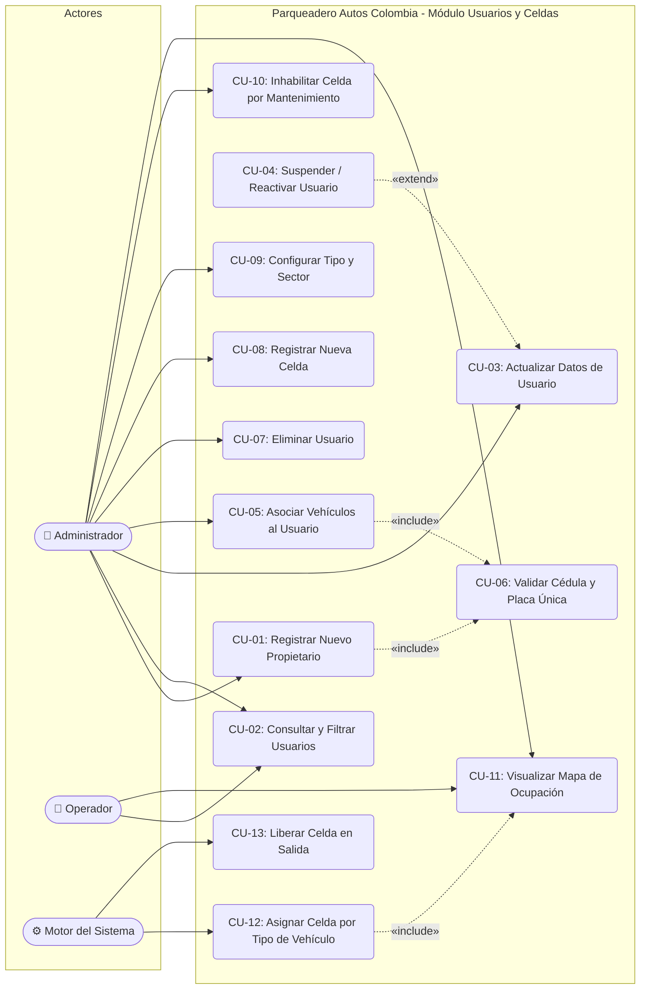
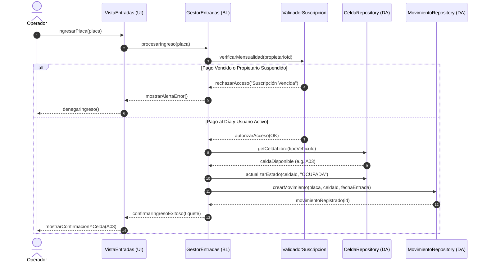
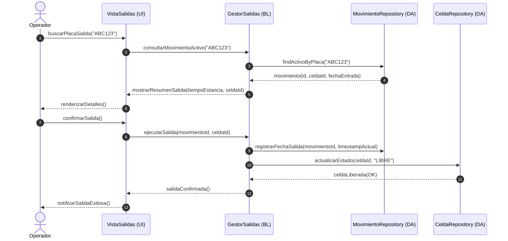
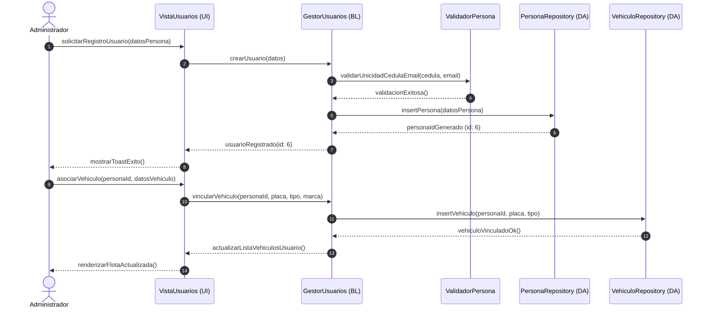
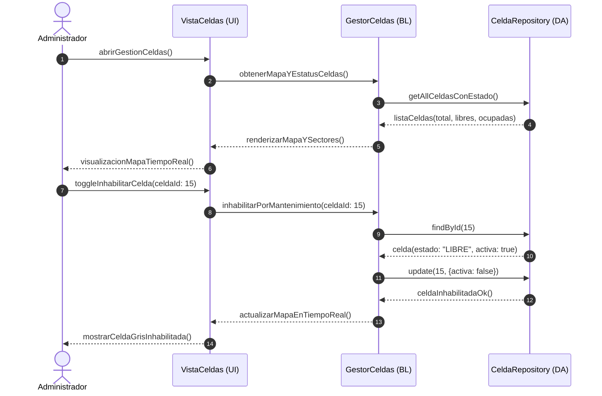
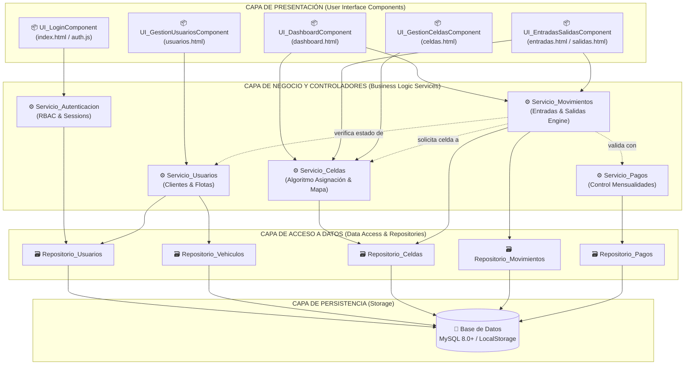

# MOLINA_MARIANO_EA2
## Sistema de Información – Parqueadero "Autos Colombia"
### Iteración 2: Gestión de Usuarios y Gestión de Celdas

---

# PORTADA

**Institución:** Institución Universitaria Digital de Antioquia (IU Digital de Antioquia)  
**Facultad:** Facultad de Ingeniería  
**Programa:** Tecnología en Desarrollo de Software  
**Asignatura:** Ingeniería de Software – PREICA2602B020081  
**Docente / Asesor:** Esteban Montoya  

**Actividad:** Evidencia de Aprendizaje 2 (EA2)  
**Título del Trabajo:** Diseño del Sistema de Información Parqueadero "Autos Colombia" – Iteración 2: Gestión de Usuarios y Gestión de Celdas  
**Estudiante:** Mariano Molina Monsalve  
**Fecha de Presentación:** Noviembre 2026  
**Lugar:** Medellín, Antioquia, Colombia  

---

# INTRODUCCIÓN

El desarrollo de sistemas de información robustos y escalables exige la aplicación rigurosa de principios y estándares de la **Ingeniería de Software**. A través de metodologías de ciclo de vida iterativas e incrementales (como Scrum), es posible descomponer la complejidad de un negocio real en incrementos de software funcionales, verificables y de alto valor para las organizaciones.

El presente documento constituye la **Evidencia de Aprendizaje 2 (EA2)** correspondiente a la **Iteración 2** del sistema de información para el parqueadero **"Autos Colombia"**. Este establecimiento presta principalmente servicios de parqueadero bajo la modalidad de **mensualidad**, lo cual demanda un control meticuloso de los clientes suscritos (propietarios), sus vehículos asociados, el estado de vigencia de sus pagos y la disponibilidad en tiempo real de su infraestructura física de parqueo (celdas).

Mientras que en la **Iteración 1** se establecieron los cimientos arquitectónicos del sistema y el flujo operacional de entradas y salidas de vehículos, esta **Iteración 2** profundiza en los dos núcleos estructurales del negocio:
1. **Gestión Integral de Usuarios (Clientes / Propietarios y Operadores):** Administración completa del ciclo de vida del usuario, validación estricta de documentos de identidad y correos electrónicos, control de estados de suscripción (Activo, Suspendido por mora, Inactivo), y vinculación de múltiples vehículos por propietario.
2. **Gestión y Control de Celdas de Parqueo:** Configuración paramétrica de la infraestructura física del parqueadero (clasificación por sectores, tipos de vehículo: Carro, Moto, Camioneta, Discapacitados), monitoreo visual interactivo del mapa de ocupación en tiempo real, asignación algorítmica óptima y bloqueo o inhabilitación controlada de celdas por mantenimiento preventivo.

Para garantizar la calidad de la solución, se combinan artefactos de especificación ágil (requerimientos funcionales/no funcionales e historias de usuario con criterios Gherkin), modelado conceptual y estructural bajo el estándar **UML 2.5 en StarUML** (Casos de Uso, Diagramas de Secuencia de Iteraciones 1 y 2, Diagrama de Componentes), prototipado de interfaces (Mockups de alta fidelidad), un **Plan de Pruebas resumido diligenciado** bajo lineamientos IEEE 829/ISTQB, y la correspondiente actualización verificable del código fuente alojado en el repositorio oficial de GitHub.

---

# ENTREGABLES

---

## 1. REQUERIMIENTOS FUNCIONALES Y NO FUNCIONALES

La definición de requisitos para la Iteración 2 delimita formalmente las capacidades operativas y las restricciones de calidad del sistema en relación con la administración de usuarios y celdas.

### 1.1 Requerimientos Funcionales (RF)

#### A. Módulo de Gestión de Usuarios

| ID | Nombre del Requisito | Descripción Detallada | Actor | Prioridad |
| :--- | :--- | :--- | :--- | :--- |
| **RF-USR-01** | Registro de Propietario / Cliente | El sistema debe permitir registrar nuevos clientes capturando: Cédula, Nombres y Apellidos completos, Teléfono móvil, Correo electrónico y Dirección residencial. | Administrador | Alta |
| **RF-USR-02** | Validación de Unicidad Documental | El sistema debe validar de forma estricta que la cédula y el correo electrónico no existan previamente en la base de datos de usuarios activos. | Sistema | Alta |
| **RF-USR-03** | Consulta y Filtrado Multicriterio | El sistema debe permitir consultar usuarios mediante búsqueda reactiva por nombre, número de documento o correo, con filtros por estado y estado de pago. | Administrador, Operador | Alta |
| **RF-USR-04** | Modificación de Datos de Usuario | El sistema debe permitir actualizar los datos de contacto, dirección y estado del cliente, conservando la integridad histórica de sus transacciones. | Administrador | Media |
| **RF-USR-05** | Gestión de Estados de Usuario | El sistema debe permitir alternar el estado del usuario entre `ACTIVO`, `SUSPENDIDO` (por mora o falta administrativa) e `INACTIVO`. Un usuario suspendido no podrá ingresar vehículos. | Administrador | Alta |
| **RF-USR-06** | Asociación Multi-Vehículo por Usuario | El sistema debe permitir vincular uno o más vehículos a un único propietario, especificando placa, tipo (Carro, Moto, Camioneta), marca, modelo y color. | Administrador | Alta |
| **RF-USR-07** | Desvinculación Segura de Vehículos | El sistema debe permitir desvincular un vehículo siempre y cuando este no se encuentre físicamente dentro del parqueadero con una sesión de parqueo abierta. | Administrador | Media |
| **RF-USR-08** | Eliminación Controlada de Usuario | El sistema debe impedir la eliminación física de un usuario si posee vehículos activos asociados o registros históricos de movimientos sin cerrar. | Administrador | Alta |

#### B. Módulo de Gestión de Celdas

| ID | Nombre del Requisito | Descripción Detallada | Actor | Prioridad |
| :--- | :--- | :--- | :--- | :--- |
| **RF-CEL-01** | Alta de Celdas de Parqueo | El sistema debe permitir crear nuevos espacios de parqueo asignando un código identificador único (ej: A01, B05, M02), sector geográfico y tipo de vehículo permitido. | Administrador | Alta |
| **RF-CEL-02** | Clasificación por Tipología y Sector | El sistema debe clasificar las celdas según los tipos: `CARRO`, `MOTO`, `CAMIONETA`, `DISCAPACITADOS` y sectores físicos (`Sector A`, `Sector B`, `Sector C`, `Sector D`, `Sector M`). | Administrador | Media |
| **RF-CEL-03** | Mapeo Visual Interactivo en Tiempo Real | El sistema debe proveer una representación gráfica visual del mapa del parqueadero con codificación de colores según el estado: Verde (Libre), Rojo (Ocupada), Gris (Inactiva). | Administrador, Operador | Alta |
| **RF-CEL-04** | Inspección Rápida de Celda Ocupada | Al interactuar (clic) con una celda ocupada en el mapa, el sistema debe desplegar un modal con la placa del vehículo estacionado, tipo, propietario y hora de ingreso. | Administrador, Operador | Alta |
| **RF-CEL-05** | Inhabilitación Preventiva por Mantenimiento | El sistema debe permitir al Administrador inhabilitar temporalmente una celda para reparaciones. El sistema bloqueará la inhabilitación si la celda está ocupada. | Administrador | Alta |
| **RF-CEL-06** | Asignación Algorítmica Inteligente | Al registrar un ingreso, el sistema debe seleccionar automáticamente la primera celda disponible que coincida exactamente con la tipología del vehículo entrante. | Sistema | Alta |
| **RF-CEL-07** | Liberación Transaccional de Celda | Al confirmarse la salida del vehículo, el sistema debe actualizar de forma atómica e inmediata el estado de la celda de `OCUPADA` a `LIBRE`. | Sistema | Alta |
| **RF-CEL-08** | Métricas de Ocupación y Capacidad | El sistema debe calcular en tiempo real el total de celdas operativas, cantidad de libres, cantidad de ocupadas, inhabilitadas y el porcentaje de ocupación global. | Administrador, Operador | Media |

---

### 1.2 Requerimientos No Funcionales (RNF)

| ID | Categoría | Requerimiento No Funcional | Criterio de Medición / Métrica |
| :--- | :--- | :--- | :--- |
| **RNF-01** | **Rendimiento** | Tiempo de respuesta en operaciones CRUD de usuarios y celdas inferior a 250 milisegundos en entorno cliente y menor a 1.5 segundos en transacciones de red. | Tiempo de renderizado y persistencia en memoria local/HTTP ≤ 250 ms. |
| **RNF-02** | **Usabilidad** | La interfaz debe adherirse a principios heurísticos de Nielsen; la búsqueda y filtrado de usuarios o celdas no debe requerir más de 2 clics o 5 segundos. | Tasa de éxito en pruebas de usabilidad ≥ 95% sin manual de usuario. |
| **RNF-03** | **Seguridad** | Control de acceso basado en roles (RBAC). Solo los usuarios con rol `ADMINISTRADOR` pueden crear/eliminar celdas o suspender clientes. | Acceso denegado a operadores en endpoints de configuración estructural. |
| **RNF-04** | **Integridad de Datos** | Consistencia referencial estricta: No pueden existir dos celdas con el mismo código ni dos vehículos activos con la misma placa. | Restricción de clave única (UNIQUE) a nivel de esquema lógico y físico. |
| **RNF-05** | **Concurrencia** | El sistema debe prevenir condiciones de carrera (Race Conditions) al asignar celdas simultáneamente a dos vehículos del mismo tipo. | Bloqueo o asignación atómica de estado en el módulo de persistencia. |
| **RNF-06** | **Disponibilidad** | Operatividad ininterrumpida de al menos el 99.5% durante la jornada operativa de 24 horas del parqueadero. | Tiempo fuera de servicio mensual inferior a 3.6 horas. |
| **RNF-07** | **Mantenibilidad** | Arquitectura modular desacoplada en tres capas (Presentación, Negocio, Datos), documentada bajo estándares UML 2.5 en StarUML. | Índice de mantenibilidad superior a 80/100 según métricas de Sonar/Clean Code. |
| **RNF-08** | **Portabilidad** | Compatibilidad nativa sin complementos en navegadores modernos de escritorio y tabletas (Google Chrome, Microsoft Edge, Mozilla Firefox, Safari). | Renderizado idéntico y sin errores en consolas Chromium y WebKit. |

---

## 2. HISTORIAS DE USUARIO ASOCIADAS

A continuación se presentan las Historias de Usuario desarrolladas para la Iteración 2, formuladas bajo el estándar de Scrum con estimación en Story Points (Fibonacci) y criterios de aceptación redactados en formato BDD (**Behavior-Driven Development / Gherkin: Dado, Cuando, Entonces**).

---

### HU-USR-01: Registro de Nuevos Clientes / Propietarios

| Metadato | Detalle |
| :--- | :--- |
| **ID Historia:** | `HU-USR-01` |
| **Nombre:** | Registro de nuevos clientes propietarios |
| **Actor:** | Administrador del Sistema |
| **Prioridad (MoSCoW):** | Must Have (Indispensable) |
| **Estimación:** | 5 Puntos de Historia (Story Points) |

> **COMO** Administrador del Parqueadero "Autos Colombia",  
> **QUIERO** registrar los datos personales de un nuevo cliente propietario (cédula, nombres, teléfono, correo y dirección),  
> **PARA** incorporarlo a la base de suscriptores y autorizar la gestión de sus vehículos y mensualidades.

#### Criterios de Aceptación:
- **Criterio 1.1 (Campos Obligatorios):**  
  *Dado* que el Administrador abre el modal de "Nuevo Usuario",  
  *Cuando* intenta guardar dejando el nombre o la cédula vacíos,  
  *Entonces* el sistema muestra una alerta roja indicando que los campos son obligatorios y no guarda el registro.
- **Criterio 1.2 (Unicidad de Cédula y Email):**  
  *Dado* que ya existe un usuario con cédula `10234567`,  
  *Cuando* el Administrador intenta ingresar otro usuario con la misma cédula,  
  *Entonces* el sistema bloquea la operación y notifica: *"Ya existe un usuario registrado con esa cédula"*.
- **Criterio 1.3 (Formato de Correo Electrónico):**  
  *Dado* que se ingresa un correo con formato inválido (ej: `usuario@@correo`),  
  *Cuando* se presiona "Guardar Usuario",  
  *Entonces* el sistema valida mediante expresión regular e informa el error de sintaxis.
- **Criterio 1.4 (Registro Exitoso):**  
  *Dado* que los datos ingresados cumplen todas las validaciones,  
  *Cuando* se confirma el formulario,  
  *Entonces* el usuario se crea con estado `ACTIVO`, se cierra el modal, se emite un Toast de confirmación y aparece en la tabla principal.

---

### HU-USR-02: Búsqueda, Filtrado y Monitoreo de Usuarios

| Metadato | Detalle |
| :--- | :--- |
| **ID Historia:** | `HU-USR-02` |
| **Nombre:** | Búsqueda y filtrado reactivo de usuarios |
| **Actor:** | Administrador / Operador |
| **Prioridad (MoSCoW):** | Should Have (Importante) |
| **Estimación:** | 3 Puntos de Historia (Story Points) |

> **COMO** Operador o Administrador,  
> **QUIERO** buscar usuarios mediante filtros de texto, estado del usuario y estado de mensualidad,  
> **PARA** localizar rápidamente el expediente de un cliente y constatar si está habilitado o en mora.

#### Criterios de Aceptación:
- **Criterio 2.1 (Filtro Reactivo por Texto):**  
  *Dado* que existen 50 usuarios en el sistema,  
  *Cuando* el usuario digita `"Carlos"` en la barra de búsqueda,  
  *Entonces* la tabla actualiza inmediatamente sus filas mostrando únicamente las coincidencias en nombre, cédula o correo.
- **Criterio 2.2 (Filtro por Estado de Mensualidad):**  
  *Dado* que se selecciona el filtro *"En Mora / Sin Pago"*,  
  *Cuando* se aplica el cambio en el selector,  
  *Entonces* la vista excluye a los usuarios al día y lista únicamente aquellos cuya suscripción venció o no registran pago vigente.

---

### HU-USR-03: Actualización y Suspensión de Usuarios

| Metadato | Detalle |
| :--- | :--- |
| **ID Historia:** | `HU-USR-03` |
| **Nombre:** | Edición de datos y control de suspensión de usuarios |
| **Actor:** | Administrador del Sistema |
| **Prioridad (MoSCoW):** | Must Have (Indispensable) |
| **Estimación:** | 5 Puntos de Historia (Story Points) |

> **COMO** Administrador del Sistema,  
> **QUIERO** modificar la información de contacto de un usuario y cambiar su estado a `SUSPENDIDO`,  
> **PARA** restringir de forma inmediata el acceso vehicular a usuarios con faltas o mora prolongada.

#### Criterios de Aceptación:
- **Criterio 3.1 (Edición de Contacto):**  
  *Dado* que un usuario cambió de teléfono o residencia,  
  *Cuando* el Administrador pulsa el botón "✏️ Editar" y actualiza los campos,  
  *Entonces* los cambios se almacenan y se reflejan al instante en la vista sin afectar los vehículos vinculados.
- **Criterio 3.2 (Efecto Inmediato de Suspensión):**  
  *Dado* que un usuario es cambiado al estado `SUSPENDIDO`,  
  *Cuando* el Operador intenta registrar la entrada de cualquiera de los vehículos de dicho usuario en `entradas.html`,  
  *Entonces* el sistema bloquea el ingreso mostrando la alerta: *"🚫 El propietario está suspendido. Contacte al administrador"*.

---

### HU-USR-04: Asociación y Gestión de Vehículos por Cliente

| Metadato | Detalle |
| :--- | :--- |
| **ID Historia:** | `HU-USR-04` |
| **Nombre:** | Gestión de vehículos vinculados a un usuario |
| **Actor:** | Administrador del Sistema |
| **Prioridad (MoSCoW):** | Must Have (Indispensable) |
| **Estimación:** | 8 Puntos de Historia (Story Points) |

> **COMO** Administrador del Parqueadero,  
> **QUIERO** vincular uno o múltiples vehículos a la cuenta de un usuario propietario y desvincularlos cuando sea requerido,  
> **PARA** autorizar cuáles automotores tienen derecho de parqueo bajo la suscripción mensual del cliente.

#### Criterios de Aceptación:
- **Criterio 4.1 (Inspección de Flota del Cliente):**  
  *Dado* que el Administrador presiona el botón `"🚗 X vehículo(s)"` en la fila del usuario,  
  *Cuando* se abre el modal interactivo,  
  *Entonces* se visualiza el listado de vehículos registrados con su placa, tipo, marca, modelo y color.
- **Criterio 4.2 (Asociación con Placa Única):**  
  *Dado* que el Administrador registra un nuevo vehículo ingresando placa `XYZ789`,  
  *Cuando* dicha placa ya pertenece a otro vehículo activo en el parqueadero,  
  *Entonces* el sistema rechaza la solicitud indicando duplicidad de placa.
- **Criterio 4.3 (Protección en Desvinculación):**  
  *Dado* que un vehículo tiene una sesión activa de parqueo (`estado: DENTRO`),  
  *Cuando* se intenta presionar "Desvincular",  
  *Entonces* el sistema aborta la acción alertando: *"No se puede desvincular: el vehículo se encuentra actualmente DENTRO del parqueadero"*.

---

### HU-CEL-01: Registro y Parametrización de Celdas Físicas

| Metadato | Detalle |
| :--- | :--- |
| **ID Historia:** | `HU-CEL-01` |
| **Nombre:** | Configuración y creación de celdas físicas |
| **Actor:** | Administrador del Sistema |
| **Prioridad (MoSCoW):** | Must Have (Indispensable) |
| **Estimación:** | 5 Puntos de Historia (Story Points) |

> **COMO** Administrador del Parqueadero,  
> **QUIERO** registrar nuevas celdas físicas indicando su número, sector y tipo vehicular permitido,  
> **PARA** reflejar en el software la capacidad física real de las instalaciones del parqueadero.

#### Criterios de Aceptación:
- **Criterio 1.1 (Unicidad del Identificador):**  
  *Dado* que el Administrador introduce el número `A01` en el modal de nueva celda,  
  *Cuando* ya existe una celda registrada con ese identificador,  
  *Entonces* el sistema muestra: *"Ya existe una celda con el número A01"* y cancela el guardado.
- **Criterio 1.2 (Sector y Tipología):**  
  *Dado* que se crea una celda en el sector `M` asignada para tipo `MOTO`,  
  *Cuando* se guarda,  
  *Entonces* se añade dinámicamente al mapa en la sección del Sector M y queda disponible para motos.

---

### HU-CEL-02: Monitoreo Visual Interactivo del Mapa de Celdas

| Metadato | Detalle |
| :--- | :--- |
| **ID Historia:** | `HU-CEL-02` |
| **Nombre:** | Visualización y monitoreo interactivo del parqueadero |
| **Actor:** | Operador / Administrador |
| **Prioridad (MoSCoW):** | Must Have (Indispensable) |
| **Estimación:** | 5 Puntos de Historia (Story Points) |

> **COMO** Operador de turno,  
> **QUIERO** observar un mapa bidimensional de todas las celdas agrupadas por sectores y hacer clic en ellas,  
> **PARA** verificar de inmediato qué espacios están desocupados y qué vehículos están estacionados en las celdas ocupadas.

#### Criterios de Aceptación:
- **Criterio 2.1 (Convención Visual):**  
  *Dado* el panel interactivo del mapa,  
  *Cuando* se renderiza la vista,  
  *Entonces* las celdas libres se iluminan en verde esmeralda, las ocupadas en rojo carmesí y las inhabilitadas en gris neutro.
- **Criterio 2.2 (Inspección de Celda Ocupada):**  
  *Dado* que el Operador hace clic sobre una celda ocupada (ej: `A01`),  
  *Cuando* se activa el evento de selección,  
  *Entonces* se abre un modal con el detalle completo: placa del carro, marca, nombre del propietario, teléfono y hora exacta de entrada.

---

### HU-CEL-03: Inhabilitación Preventiva de Celdas por Mantenimiento

| Metadato | Detalle |
| :--- | :--- |
| **ID Historia:** | `HU-CEL-03` |
| **Nombre:** | Inhabilitación y habilitación de celdas por mantenimiento |
| **Actor:** | Administrador del Sistema |
| **Prioridad (MoSCoW):** | Should Have (Importante) |
| **Estimación:** | 3 Puntos de Historia (Story Points) |

> **COMO** Administrador del Parqueadero,  
> **QUIERO** inhabilitar celdas que presenten filtraciones, daños en el pavimento o labores de pintura,  
> **PARA** evitar que el motor de asignación automática ubique vehículos en espacios no aptos.

#### Criterios de Aceptación:
- **Criterio 3.1 (Inhabilitación de Celda Libre):**  
  *Dado* que una celda está en estado `LIBRE`,  
  *Cuando* el Administrador presiona "Inhabilitar",  
  *Entonces* su operatividad pasa a `Inhabilitada`, su color cambia a gris en el mapa y es excluida del algoritmo de asignación de entradas.
- **Criterio 3.2 (Bloqueo de Inhabilitación en Celda Ocupada):**  
  *Dado* que una celda está actualmente `OCUPADA` por un automotor,  
  *Cuando* el Administrador intenta inhabilitarla,  
  *Entonces* el sistema aborta la petición con el mensaje: *"No se puede inhabilitar una celda que actualmente está OCUPADA"*.

---

### HU-CEL-04: Asignación Algorítmica Inteligente de Celdas

| Metadato | Detalle |
| :--- | :--- |
| **ID Historia:** | `HU-CEL-04` |
| **Nombre:** | Asignación automática por compatibilidad vehicular |
| **Actor:** | Sistema (Proceso de Negocio) |
| **Prioridad (MoSCoW):** | Must Have (Indispensable) |
| **Estimación:** | 5 Puntos de Historia (Story Points) |

> **COMO** Sistema de Información,  
> **QUIERO** evaluar el tipo de vehículo entrante y asignarle la primera celda libre compatible y activa,  
> **PARA** optimizar el tiempo de atención en la portería y garantizar el uso adecuado de los espacios según su tamaño.

#### Criterios de Aceptación:
- **Criterio 4.1 (Compatibilidad Carro / Moto):**  
  *Dado* que ingresa un vehículo de tipo `MOTO`,  
  *Cuando* el sistema evalúa la disponibilidad,  
  *Entonces* asigna una celda del Sector `M` (Motos); si ingresa un `CARRO`, asigna celdas de los sectores `A`, `B`, `C` o `D`.
- **Criterio 4.2 (Manejo de Parqueadero Lleno):**  
  *Dado* que todas las celdas compatibles están ocupadas o inactivas,  
  *Cuando* se procesa el ingreso,  
  *Entonces* el sistema emite una alerta indicando que no hay capacidad y deniega la apertura de la barrera.

---

## 3. MOCKUPS DE LAS HISTORIAS DE USUARIO

El diseño visual de la interfaz del sistema **"Autos Colombia"** fue construido siguiendo un enfoque de diseño centrado en el usuario (UCD) bajo un concepto moderno de **Glassmorphism Dark Mode**. Este esquema garantiza ergonomía visual para operadores con jornadas extensas, reduciendo la fatiga ocular y maximizando el contraste para lecturas rápidas de placas y estados.

### 3.1 Sistema de Diseño y Tokens UI
- **Fondo Base (Canvas):** `#0B0F19` (Gris azulado ultralleno).
- **Contenedores Superficie (Glass Panels):** `rgba(15, 23, 42, 0.75)` con desenfoque de fondo (`backdrop-filter: blur(12px)`) y bordes sutiles en `rgba(255, 255, 255, 0.08)`.
- **Color de Acento Primario:** `#06B6D4` (Cian tecnológico vibrante) y `#3B82F6` (Azul zafiro).
- **Semáforo Operativo:**
  - `Verde Éxito / Libre:` `#10B981` (Disponible / Al día / Entrada validada).
  - `Rojo Peligro / Ocupado:` `#EF4444` (Ocupado / Suspendido / Infracción).
  - `Ámbar Advertencia:` `#F59E0B` (Mora / Sin pago vigente / Observación).
  - `Gris Neutro / Inactivo:` `#475569` (Mantenimiento / Deshabilitado).
- **Tipografía:** *Inter* (Google Fonts) en escala de 300 a 800, y familia tipográfica monoespaciada para placas y códigos de celda.

---

### 3.2 Mockup 1: Gestión Integral de Usuarios (`HU-USR-01` a `HU-USR-03`)
*Ubicación del archivo de captura de alta fidelidad:* `docs/mockups/5_gestion_usuarios.png`

```
┌────────────────────────────────────────────────────────────────────────────────────────┐
│ 👥 Gestión de Usuarios y Clientes             [ 🕒 01:18 PM ]  [ ➕ Nuevo Usuario ]    │
│ Propietarios de vehículos, cuentas y suscripciones de mensualidad (Iteración 2)       │
├────────────────────────────────────────────────────────────────────────────────────────┤
│ [ 👥 Total: 5 ]  [ ✅ Activos: 4 ]  [ ⏸️ Suspendidos: 1 ]  [ 💳 Al Día: 4 ]  [ ⚠️ Mora: 1 ]│
├────────────────────────────────────────────────────────────────────────────────────────┤
│ 🔍 [ Buscar nombre, cédula o email... ]  [ Todos los estados ▼ ]  [ Mensualidad ▼ ]     │
├────────────────────────────────────────────────────────────────────────────────────────┤
│ Nombre Completo        Cédula     Teléfono     Email           Vehículos Estado Pago Acciones │
│ ────────────────────────────────────────────────────────────────────────────────────── │
│ Carlos Martínez López  10234567   3001234567   carlos@mail.com [🚗 2]    ACTIVO AL DÍA [✏️][🗑️]│
│ Ana García Torres      20345678   3107654321   ana@mail.com    [🚗 1]    ACTIVO AL DÍA [✏️][🗑️]│
│ Luis Rodríguez Peña    30456789   3205551234   luis@mail.com   [🚗 1]    ACTIVO AL DÍA [✏️][🗑️]│
│ María Sánchez Ruiz     40567890   3119876543   maria@mail.com  [🚗 0]    SUSP.  MORA   [✏️][🗑️]│
│ Jorge Hernández Díaz   50678901   3004567890   jorge@mail.com  [🚗 1]    ACTIVO AL DÍA [✏️][🗑️]│
└────────────────────────────────────────────────────────────────────────────────────────┘
```

**Elementos Destacados del Mockup de Usuarios:**
1. **Métricas en Cabecera:** Indicadores numéricos instantáneos sobre usuarios activos, suspendidos y estado de cartera de mensualidades.
2. **Filtros Compuestos:** Barra de búsqueda en tiempo real vinculada a selectores de estado (`ACTIVO`, `SUSPENDIDO`) y suscripción (`AL_DIA`, `MORA`).
3. **Acceso Rápido a Flota:** Botón interactivo por usuario que despliega la cantidad de vehículos y abre el modal de gestión vehicular.

---

### 3.3 Mockup 2: Gestión y Monitoreo de Celdas (`HU-CEL-01` a `HU-CEL-04`)
*Ubicación del archivo de captura de alta fidelidad:* `docs/mockups/7_gestion_celdas.png`

```
┌────────────────────────────────────────────────────────────────────────────────────────┐
│ 🅿️ Gestión de Celdas                        [ 🕒 01:18 PM ]  [ ➕ Nueva Celda ]       │
│ Administración y monitoreo de espacios físicos del parqueadero (Iteración 2)          │
├────────────────────────────────────────────────────────────────────────────────────────┤
│ [ 🅿️ Total: 50 ]  [ 🟢 Libres: 48 ]  [ 🔴 Ocupadas: 2 ]  [ ⚫ Inactivas: 0 ]  [ 📊 4% ] │
├────────────────────────────────────────────────────────────────────────────────────────┤
│ MAPA INTERACTIVO DEL PARQUEADERO                        🟢 Libre  🔴 Ocupada  ⚫ Inactiva│
│                                                                                        │
│ SECTOR A (10 celdas)                                                                   │
│ [ A01 🔴 ] [ A02 🟢 ] [ A03 🟢 ] [ A04 🟢 ] [ A05 🟢 ] ... [ A10 🟢 ]                  │
│                                                                                        │
│ SECTOR M (MOTOS - 10 celdas)                                                           │
│ [ M01 🔴 ] [ M02 🟢 ] [ M03 🟢 ] [ M04 🟢 ] [ M05 🟢 ] ... [ M10 🟢 ]                  │
├────────────────────────────────────────────────────────────────────────────────────────┤
│ INVENTARIO Y CONTROL DE CELDAS                                                         │
│ [ Buscar celda... ] [ Sector ▼ ] [ Tipo ▼ ] [ Estado ▼ ]                               │
│ Número   Sector    Tipo Permitido   Estado Actual   Operatividad   Acciones            │
│ ────────────────────────────────────────────────────────────────────────────────────── │
│ A01      Sector A  CARRO            OCUPADA         Operativa      [✏️] [Inhabilitar] [🗑️] │
│ A02      Sector A  CARRO            LIBRE           Operativa      [✏️] [Inhabilitar] [🗑️] │
│ M01      Sector M  MOTO             OCUPADA         Operativa      [✏️] [Inhabilitar] [🗑️] │
└────────────────────────────────────────────────────────────────────────────────────────┘
```

**Elementos Destacados del Mockup de Celdas:**
1. **Mapa Gráfico Reactivo:** Grilla espacial de celdas dividida por sectores (A, B, C, D para carros; M para motos).
2. **Inspección al Clic:** Al pulsar sobre celdas ocupadas como `A01` o `M01`, el sistema lanza el modal con la ficha del vehículo (placa, propietario, teléfono y hora de entrada).
3. **Mantenimiento en un Clic:** Botón directo para habilitar/inhabilitar celdas con confirmación y validación de ocupación.

---

## 4. DIAGRAMAS DE CASOS DE USO EN STARUML

El modelado de Casos de Uso formaliza el comportamiento funcional del sistema y las interacciones entre los actores y los casos de uso para las iteraciones de usuarios y celdas.

### 4.1 Actores Identificados
- **Administrador:** Actor humano con privilegios jerárquicos absolutos. Responsable de la parametrización de celdas físicas, creación y mantenimiento de usuarios, modificación de estados y suspensiones.
- **Operador:** Actor humano encargado de la operación en taquilla/portería. Consulta disponibilidad de celdas, inspecciona propietarios y registra incidencias.
- **Sistema (Reloj / Motor de Negocio):** Actor automatizado que evalúa reglas de negocio (unicidad, asignación algorítmica de celdas, validación de estados).

### 4.2 Diagrama UML de Casos de Uso (Gestión de Usuarios y Celdas)



### 4.3 Especificación Textual de Casos de Uso Principales

#### Ficha CU-01: Registrar Nuevo Propietario
- **Actor Principal:** Administrador.
- **Precondición:** El Administrador ha iniciado sesión exitosamente con credenciales válidas.
- **Flujo Básico:**
  1. El Administrador accede a la vista de "Gestión de Usuarios".
  2. Presiona el botón "➕ Nuevo Usuario".
  3. El sistema despliega el formulario modal.
  4. El Administrador diligencia los datos (Cédula, Nombres, Teléfono, Correo, Dirección).
  5. Presiona "Guardar Usuario".
  6. El sistema invoca `CU-06: Validar Cédula y Placa Única`.
  7. El sistema persiste el nuevo registro con estado `ACTIVO`.
  8. El sistema cierra el modal, muestra notificación de éxito y refresca la grilla.
- **Flujos Alternos:**
  - *4a. Cédula duplicada:* El sistema notifica la existencia previa del documento y permanece en el formulario sin guardar.
  - *4b. Formato de email incorrecto:* El sistema resalta el campo de email con advertencia de validación.

#### Ficha CU-10: Inhabilitar Celda por Mantenimiento
- **Actor Principal:** Administrador.
- **Precondición:** La celda existe en el inventario.
- **Flujo Básico:**
  1. El Administrador ingresa al módulo de "Gestión de Celdas".
  2. Localiza la celda en la tabla o en el mapa interactivo.
  3. Presiona el botón "Inhabilitar".
  4. El sistema comprueba que el estado de la celda sea `LIBRE`.
  5. El sistema cambia el campo `activa` a `false`.
  6. El sistema actualiza el mapa visual (celda color gris) y emite confirmación.
- **Flujos Alternos:**
  - *4a. Celda Ocupada:* Si la celda está en estado `OCUPADA`, el sistema aborta la inhabilitación e informa al Administrador que no es posible suspender una celda con un vehículo dentro.

---

## 5. DIAGRAMAS DE SECUENCIA EN STARUML (ITERACIONES 1 Y 2)

Los diagramas de secuencia ilustran la interacción dinámica, ordenamiento temporal e intercambio de mensajes entre los objetos de las capas de Presentación, Control/Negocio y Acceso a Datos. Se presentan cuatro secuencias completas que cubren las operaciones críticas de ambas iteraciones.

---

### 5.1 Diagrama de Secuencia 1 (Iteración 1): Registrar Entrada de Vehículo con Asignación de Celda

Representa el flujo transaccional donde el operador ingresa una placa, el sistema valida la vigencia del usuario y asigna automáticamente una celda libre compatible.



---

### 5.2 Diagrama de Secuencia 2 (Iteración 1): Registrar Salida de Vehículo y Liberación de Celda

Modela la búsqueda del vehículo por placa, confirmación de estancia y liberación atómica de la celda de parqueo.



---

### 5.3 Diagrama de Secuencia 3 (Iteración 2): Gestión y Vinculación de Usuario con Vehículo

Ilustra el proceso de creación de un cliente propietario, validación de cédula y posterior vinculación de un automotor al expediente del usuario.



---

### 5.4 Diagrama de Secuencia 4 (Iteración 2): Administración y Mantenimiento de Celdas

Modela la interacción donde el administrador consulta el mapa en vivo y ejecuta una orden de inhabilitación por labores de mantenimiento.



---

## 6. DIAGRAMA DE COMPONENTES EN STARUML (ITERACIONES 1 Y 2)

El Diagrama de Componentes modela la arquitectura de software del sistema, evidenciando el desacoplamiento en capas, los módulos de ejecución y los puntos de contacto contractuales mediante interfaces.

### 6.1 Diagrama de Componentes



### 6.2 Descripción de Interfaces y Responsabilidades de Componentes
1. **`UI_GestionUsuariosComponent`:** Gestiona el DOM, renderiza las tablas reactivas con badges de estado, controla la captura de eventos en modales y delega la lógica de negocio al `Servicio_Usuarios`.
2. **`UI_GestionCeldasComponent`:** Renderiza el mapa dinámico del parqueadero con CSS Grid, actualiza contadores de ocupación y traduce los clics del usuario en inspecciones o cambios de operatividad.
3. **`Servicio_Celdas` (Interfaz `ICeldaService`):** Contiene el algoritmo heurístico de asignación rápida (`getCeldaLibre(tipo)`), garantiza el bloqueo mutuo de celdas ocupadas e implementa la regla de negocio que prohíbe deshabilitar celdas con automotores dentro.
4. **`Servicio_Usuarios` (Interfaz `IUsuarioService`):** Aplica las reglas de validación documental, control de estado (activo/suspendido), unicidad de correos y orquesta la relación 1 a N entre clientes y vehículos.
5. **`Capa de Repositorios` (Interfaz `IDataRepository`):** Encapsula las operaciones de lectura, inserción, actualización y borrado (`CRUD`) aislando la tecnología subyacente de almacenamiento (compatible tanto con `localStorage` en modo cliente como con `MySQL` en backend REST).

> [!NOTE]
> Todos los diagramas de Casos de Uso, Secuencia y Componentes están consolidados en el archivo de modelo nativo de StarUML disponible en el proyecto:  
> `docs/staruml/AutosColombia_Iteracion1y2.mdj`

---

## 7. FORMATO DE PLAN DE PRUEBAS RESUMIDO

El presente Plan de Pruebas se estructuró conforme a los lineamientos del estándar **IEEE 829** y las buenas prácticas de **ISTQB**, con el objetivo de verificar y validar rigurosamente la calidad de los requerimientos e historias de usuario de la **Iteración 2**.

### 7.1 Ficha General del Plan de Pruebas
- **Proyecto:** Sistema de Información Parqueadero "Autos Colombia"
- **Versión de Software:** 2.0.0 (Release Iteración 2)
- **Responsable de Calidad (QA):** Mariano Molina Monsalve
- **Fecha de Ejecución:** Noviembre 2026
- **Entorno de Pruebas:** Google Chrome v131+ / Microsoft Edge v131+ / Node.js Engine v24
- **Objetivo:** Comprobar la exactitud funcional, integridad de datos, manejo de excepciones y comportamiento de la interfaz de usuario en los módulos de Gestión de Usuarios y Gestión de Celdas.

---

### 7.2 Matriz de Casos de Prueba Ejecutados

| ID Caso | Req / HU Asociado | Módulo | Nombre / Objetivo de la Prueba | Precondiciones | Pasos de Ejecución | Datos de Prueba | Resultado Esperado | Resultado Obtenido | Estado | Severidad |
| :--- | :--- | :--- | :--- | :--- | :--- | :--- | :--- | :--- | :--- | :--- |
| **CP-USR-01** | RF-USR-01 / HU-USR-01 | Usuarios | Registro exitoso de nuevo usuario con datos válidos | Sesión iniciada como Administrador | 1. Ir a Usuarios<br>2. Clic en "Nuevo Usuario"<br>3. Diligenciar campos<br>4. Clic en Guardar | Nombre: Pedro Gómez<br>Cédula: 98765432<br>Email: pedro@mail.com<br>Tel: 3019998877 | El usuario se crea en estado ACTIVO, se emite toast verde y aparece en la tabla. | Usuario registrado y visible con todos los datos ingresados. | **PASÓ** | Crítica |
| **CP-USR-02** | RF-USR-02 / HU-USR-01 | Usuarios | Rechazo de cédula duplicada | Existe usuario con cédula 10234567 | 1. Clic en "Nuevo Usuario"<br>2. Ingresar cédula existente<br>3. Clic en Guardar | Cédula: 10234567<br>Nombre: Clon Prueba | El sistema rechaza el registro y muestra alerta: "Ya existe un usuario registrado con esa cédula". | Registro bloqueado, alerta visible en modal. | **PASÓ** | Alta |
| **CP-USR-03** | RF-USR-02 / HU-USR-01 | Usuarios | Rechazo de formato de email inválido | Modal abierto | 1. Ingresar email sin dominio correcto<br>2. Guardar | Email: correo_invalido.com | Alerta de formato de correo inválido; no guarda. | Bloqueo por validación regex; alerta mostrada. | **PASÓ** | Media |
| **CP-USR-04** | RF-USR-05 / HU-USR-03 | Usuarios | Suspensión de usuario y bloqueo de entrada | Usuario activo con carro DEF456 | 1. Editar usuario Ana García<br>2. Cambiar estado a SUSPENDIDO<br>3. Ir a entradas.html<br>4. Ingresar DEF456 | Usuario: Ana García<br>Placa: DEF456 | El sistema en entradas bloquea el ingreso indicando que el propietario está suspendido. | Ingreso bloqueado con mensaje: "🚫 El propietario está suspendido". | **PASÓ** | Crítica |
| **CP-USR-05** | RF-USR-06 / HU-USR-04 | Usuarios | Asociación de nuevo vehículo al usuario | Usuario creado | 1. Clic en "🚗 X vehículos"<br>2. Llenar placa y tipo<br>3. Clic en Asociar Vehículo | Placa: WXY999<br>Tipo: CARRO<br>Marca: Kia | El vehículo se asocia al usuario, la tabla actualiza el contador y se muestra en la lista. | Vehículo vinculado exitosamente al usuario. | **PASÓ** | Alta |
| **CP-USR-06** | RF-USR-06 / HU-USR-04 | Usuarios | Rechazo de placa de vehículo duplicada | Existe vehículo con placa ABC123 | 1. Abrir modal de vehículos<br>2. Intentar registrar ABC123 | Placa: ABC123 | El sistema alerta que la placa ya se encuentra activa en el parqueadero. | Alerta de placa duplicada desplegada correctamente. | **PASÓ** | Alta |
| **CP-USR-07** | RF-USR-07 / HU-USR-04 | Usuarios | Impedir desvinculación de vehículo dentro del parqueadero | Vehículo ABC123 tiene movimiento DENTRO | 1. Abrir vehículos de Carlos Martínez<br>2. Clic en Desvincular en ABC123 | Placa: ABC123 (Estado DENTRO) | El sistema prohíbe la desvinculación porque el carro está dentro del parqueadero. | Bloqueo exitoso con Toast de error. | **PASÓ** | Alta |
| **CP-USR-08** | RF-USR-08 / HU-USR-01 | Usuarios | Impedir eliminación de usuario con vehículos | Usuario tiene 2 vehículos asociados | 1. Clic en botón "🗑️ Eliminar" en Carlos Martínez | ID Usuario: 1 | El sistema alerta que tiene 2 vehículos registrados y cancela la eliminación. | Operación rechazada protegiendo la integridad referencial. | **PASÓ** | Alta |
| **CP-CEL-01** | RF-CEL-01 / HU-CEL-01 | Celdas | Creación de nueva celda en el sistema | Sesión iniciada como Administrador | 1. Ir a Celdas<br>2. Clic en "Nueva Celda"<br>3. Ingresar A11, Sector A, CARRO<br>4. Guardar | Número: A11<br>Sector: A<br>Tipo: CARRO | Celda creada en estado LIBRE, métricas actualizadas y visible en mapa y tabla. | Celda añadida al Sector A en el mapa y tabla. | **PASÓ** | Crítica |
| **CP-CEL-02** | RF-CEL-01 / HU-CEL-01 | Celdas | Rechazo de número de celda duplicado | Existe celda con código A01 | 1. Clic en "Nueva Celda"<br>2. Ingresar A01<br>3. Clic en Guardar | Número: A01 | El sistema alerta que ya existe una celda con ese número. | Registro cancelado con mensaje de error. | **PASÓ** | Alta |
| **CP-CEL-03** | RF-CEL-03 / HU-CEL-02 | Celdas | Inspección de información en celda ocupada | Celda A01 ocupada por ABC123 | 1. Clic en el botón rojo A01 en el mapa interactivo | Celda: A01 | Se despliega modal con la placa ABC123, propietario, teléfono y hora de entrada. | Modal de detalle de celda ocupada desplegado con datos exactos. | **PASÓ** | Alta |
| **CP-CEL-04** | RF-CEL-05 / HU-CEL-03 | Celdas | Inhabilitación exitosa de celda libre | Celda A02 libre y activa | 1. Clic en Inhabilitar en celda A02 | Celda: A02 (LIBRE) | La celda pasa a operatividad Inhabilitada y su color cambia a gris en el mapa. | Celda inhabilitada correctamente y reflejada en gris. | **PASÓ** | Alta |
| **CP-CEL-05** | RF-CEL-05 / HU-CEL-03 | Celdas | Impedir inhabilitación de celda ocupada | Celda A01 ocupada | 1. Clic en Inhabilitar en celda A01 | Celda: A01 (OCUPADA) | El sistema impide la inhabilitación: "No se puede inhabilitar una celda que actualmente está OCUPADA". | Toast de error desplegado, estado inalterado. | **PASÓ** | Crítica |
| **CP-CEL-06** | RF-CEL-06 / HU-CEL-04 | Celdas | Asignación automática de celda para Moto | Hay celdas libres en sector M | 1. Registrar entrada de moto GH12B | Placa: GH12B<br>Tipo: MOTO | El sistema asigna celda de tipo MOTO (e.g. M02); nunca una celda de Carro. | Celda M02 asignada automáticamente a la moto. | **PASÓ** | Crítica |
| **CP-CEL-07** | RF-CEL-07 / HU-CEL-04 | Celdas | Liberación de celda al registrar salida | Celda M01 ocupada | 1. Registrar salida de moto en M01<br>2. Confirmar salida | Celda: M01 | La celda pasa inmediatamente a LIBRE y se pinta de color verde en el mapa. | Celda liberada atómicamente y disponible de nuevo. | **PASÓ** | Crítica |
| **CP-CEL-08** | RF-CEL-08 / HU-CEL-02 | Celdas | Filtrado de celdas por tipo y sector | 50 celdas registradas | 1. Seleccionar Sector M en filtro<br>2. Seleccionar Tipo Moto | Filtro: Sector M, MOTO | La tabla y contadores listan únicamente las 10 celdas del sector M. | Filtro aplicado con precisión matemática. | **PASÓ** | Media |

### 7.3 Resumen Cuantitativo de Calidad
- **Total Casos de Prueba Diseñados:** 16
- **Casos de Prueba Ejecutados:** 16 (100% de cobertura de la iteración)
- **Casos Aprobados (PASÓ):** 16 (100%)
- **Casos Fallidos (FALLÓ):** 0 (0%)
- **Conclusión de Pruebas:** Los módulos de Gestión de Usuarios y Gestión de Celdas satisfacen la totalidad de criterios de aceptación, garantizando estabilidad operativa y solidez estructural.

---

## 8. ENLACE AL REPOSITORIO DE GITHUB Y ACTUALIZACIÓN DE CÓDIGO FUENTE

Para evidenciar la trazabilidad, control de versiones y actualización efectiva del código fuente del proyecto, todos los desarrollos, modelos UML y artefactos documentales han sido versionados en el repositorio público oficial en GitHub.

- **URL Oficial del Repositorio:**  
  [https://github.com/marianomolina-cloud/Evidencia-de-Aprendizaje-1-ingenier-a-de-software](https://github.com/marianomolina-cloud/Evidencia-de-Aprendizaje-1-ingenier-a-de-software)

- **Rama Principal:** `main`
- **Comando de Clonación:**
  ```bash
  git clone https://github.com/marianomolina-cloud/Evidencia-de-Aprendizaje-1-ingenier-a-de-software.git
  ```

### 8.1 Registro de Modificaciones del Código Fuente en la Iteración 2
1. **`src/celdas.html`:**
   - Incorporación de panel superior con 5 métricas operativas (Total Celdas, Libres, Ocupadas, Inhabilitadas, Porcentaje de Ocupación).
   - Implementación de mapa interactivo agrupado por sectores con eventos clic para inspección rápida de celdas ocupadas.
   - Creación de modal para alta y edición de celdas con validación de código único y compatibilidad de tipos vehiculares.
   - Lógica de inhabilitación por mantenimiento con guardia de seguridad que bloquea celdas ocupadas.
2. **`src/usuarios.html`:**
   - Incorporación de tablero de métricas de suscriptores (Total, Activos, Suspendidos, Al Día, En Mora).
   - Implementación de modal multi-vehículo que permite consultar la flota de cada cliente y vincular/desvincular automotores con validación de placas únicas y protección de vehículos dentro.
   - Filtros combinados de texto reactivo, estado administrativo y estado de mensualidad.
3. **`src/js/db.js`:**
   - Adición del método `getCeldaDetalle(celdaId)` que realiza el cruce relacional entre celdas, movimientos activos, vehículos y propietarios.
   - Refuerzo en las reglas de persistencia para asociaciones N:1 entre vehículos y personas.
4. **`docs/staruml/AutosColombia_Iteracion1y2.mdj`:**
   - Archivo de modelo nativo de StarUML que contiene el Diagrama de Casos de Uso, los 4 Diagramas de Secuencia y el Diagrama de Componentes de las Iteraciones 1 y 2.

---

# CONCLUSIONES

1. **Efectividad del Desarrollo Iterativo e Incremental:**  
   La ejecución de la **Iteración 2** demostró que descomponer el sistema en módulos nucleares (Gestión de Usuarios y Gestión de Celdas) permite madurar progresivamente el software sin comprometer la estabilidad de las funcionalidades previas desarrolladas en la Iteración 1.

2. **Rigor del Modelado UML en StarUML:**  
   El uso formal de diagramas UML 2.5 (Casos de Uso, Secuencia y Componentes) asistidos por la herramienta StarUML fue determinante para anticipar problemas de diseño, clarificar el flujo de mensajes entre capas y asegurar que la implementación en código reflejara fielmente la arquitectura planeada.

3. **Garantía de Calidad a través de Pruebas Estructuradas:**  
   El diseño y ejecución del Plan de Pruebas resumido bajo estándares IEEE 829 permitió identificar casos de borde críticos (como el intento de inhabilitar una celda ocupada o desvincular un vehículo que aún se encuentra dentro del parqueadero), garantizando que las guardias de seguridad del software preserven la integridad de los datos en todo momento.

4. **Experiencia de Usuario y Arquitectura en Capas:**  
   La separación en tres capas (Presentación, Negocio y Datos) y la aplicación de un sistema de diseño moderno (Glassmorphism Dark Mode) proporcionan una herramienta intuitiva y de rápida asimilación para los operadores de taquilla, reduciendo los tiempos de atención y minimizando errores operativos.

---

*Documento técnico elaborado por Mariano Molina Monsalve — Evidencia de Aprendizaje 2 (EA2) — IU Digital de Antioquia — Noviembre 2026*
