# MOLINA_MARIANO_EA3
## Sistema de Información – Parqueadero "Autos Colombia"
### Iteración 3: Gestión de Pagos y Consolidación Arquitectónica (3 Iteraciones)

---

# PORTADA

**Institución:** Institución Universitaria Digital de Antioquia (IU Digital de Antioquia)  
**Programa Académico:** Tecnología en Desarrollo de Software  
**Asignatura:** Ingeniería de Software – PREICA2602B020081  
**Docente / Asesor:** Esteban Montoya  

**Actividad Académica:** Evidencia de Aprendizaje 3 (EA3)  
**Título del Trabajo:** Diseño del Sistema de Información Parqueadero "Autos Colombia" – Iteración 3: Gestión de Pagos  
**Estudiante:** Mariano Molina Monsalve  
**Fecha de Presentación:** Noviembre 2026   

---

# INTRODUCCIÓN

En el marco de la **Ingeniería de Software**, la concepción y materialización de sistemas de información empresariales demanda la aplicación de metodologías rigurosas que garanticen la trazabilidad, la calidad técnica y la satisfacción integral de las necesidades operativas de la organización. La adopción de ciclos de vida **iterativos e incrementales**, tales como el marco ágil **Scrum**, permite mitigar el riesgo intrínseco del desarrollo mediante la entrega escalonada de incrementos de software funcionales, verificables y de alto impacto.

El presente documento constituye la memoria técnica formal de la **Evidencia de Aprendizaje 3 (EA3)**, correspondiente a la **Iteración 3: Gestión de Pagos**, con la cual se culmina el ciclo integral de desarrollo para el parqueadero comercial **"Autos Colombia"**. Este establecimiento fundamenta su modelo de negocio en la prestación de servicios de estacionamiento bajo la modalidad de **mensualidad fija**, esquema que exige un control minucioso de sus ingresos, una estricta validación de los derechos de acceso de los vehículos en garita y una correspondencia directa entre los pagos recibidos y la infraestructura física reservada.

A lo largo del proyecto se ha seguido una evolución sistemática estructurada en tres iteraciones interdependientes:
1. **Iteración 1 (Gestión de Entradas y Salidas):** Cimentó el flujo operativo del parqueadero, la captura rápida de placas en garita, el cálculo automático de tiempos de estancia y la asignación atómica de celdas según tipología vehicular.
2. **Iteración 2 (Gestión de Usuarios y Gestión de Celdas):** Estableció el núcleo estructural del sistema, permitiendo el registro y administración del ciclo de vida de los clientes suscriptores, la vinculación múltiple de vehículos por propietario y la administración interactiva del mapa de celdas con inhabilitación preventiva por mantenimiento.
3. **Iteración 3 (Gestión de Pagos y Cartera):** Cierra el ciclo de valor del negocio mediante la implementación del subsistema financiero y tarifario: recaudación de mensualidades, liquidación automatizada de valores según la categoría vehicular (Carro, Moto, Camioneta), emisión de recibos y comprobantes digitales oficiales con numeración consecutiva, control proactivo de cartera con detección de morosidad y articulación transaccional con la garita de acceso para condicionar el ingreso a la vigencia del pago.

Para validar el rigor metodológico, este documento consolida la especificación formal de requerimientos funcionales y no funcionales, historias de usuario estructuradas bajo la sintaxis **BDD / Gherkin**, prototipos de interfaz de alta fidelidad (**Mockups**), el modelado conceptual bajo el estándar internacional **UML 2.5 en StarUML** (Casos de Uso, Diagramas de Secuencia que integran las 3 iteraciones y Diagrama de Componentes arquitectónico), un **Plan de Pruebas Resumido** exhaustivamente diligenciado bajo directrices ISTQB/IEEE 829, y el enlace al repositorio oficial en GitHub que certifica la actualización y disponibilidad del código fuente funcional.

---

# ENTREGABLES

---

## 1. REQUERIMIENTOS FUNCIONALES Y NO FUNCIONALES (GESTIÓN DE PAGOS)

La especificación de requisitos delimita con precisión matemática y funcional el alcance del subsistema de pagos y su interconexión con los módulos operativos previamente construidos.

### 1.1 Requerimientos Funcionales (RF)

| ID | Nombre del Requisito | Descripción Detallada | Actor Principal | Prioridad (MoSCoW) |
| :--- | :--- | :--- | :--- | :--- |
| **RF-PAG-01** | Registro de Pago de Mensualidad | El sistema debe permitir registrar transacciones de pago de mensualidades capturando suscriptor, mes/año cubierto, fecha de pago, monto y método de pago (Efectivo, Transferencia/PSE, Tarjeta). | Operador / Cajero, Administrador | Alta (Must Have) |
| **RF-PAG-02** | Liquidación Automática de Tarifas por Vehículo | Al seleccionar el suscriptor y su vehículo, el sistema debe prellenar automáticamente la tarifa oficial configurada según la tipología: Carro ($120.000), Moto ($80.000) o Camioneta ($150.000). | Sistema, Cajero | Alta (Must Have) |
| **RF-PAG-03** | Generación de Recibo Digital Oficial | Al confirmar el pago, el sistema debe expedir instantáneamente un comprobante digital con consecutivo único irrepetible (`REC-YYYY-XXXX`), NIT institucional, desglose de cobertura y código de barras. | Operador / Cajero, Suscriptor | Alta (Must Have) |
| **RF-PAG-04** | Validación de Vigencia en Garita de Acceso | Al ingresar una placa en garita, el sistema debe comprobar de forma síncrona si el propietario tiene una mensualidad activa. Si está vencida o en mora, el sistema denegará automáticamente el ingreso vehicular. | Sistema, Operador Garita | Alta (Must Have) |
| **RF-PAG-05** | Monitoreo de Cartera y Detección de Morosos | El sistema debe proveer una vista de cartera que liste en tiempo real los clientes sin mensualidad activa para el mes en curso, indicando datos de contacto, vehículos y último período pagado. | Administrador, Cajero | Alta (Must Have) |
| **RF-PAG-06** | Reactivación Automática de Suscriptor | Si un cliente en estado `SUSPENDIDO` por mora cancela su mensualidad adeudada, el sistema debe reactivar inmediatamente su estado a `ACTIVO`. | Sistema | Alta (Must Have) |
| **RF-PAG-07** | Prevención de Pagos Duplicados | El sistema debe validar que no se registre más de un pago vigente para el mismo suscriptor en un mismo mes de cobertura, evitando inconsistencias contables. | Sistema | Alta (Must Have) |
| **RF-PAG-08** | Consulta y Filtrado Multicriterio de Pagos | El sistema debe permitir buscar pagos por número de recibo, cédula o nombre del cliente, con filtros dinámicos por estado (`VIGENTE`, `VENCIDO`, `ANULADO`) y medio de pago. | Administrador, Operador | Media (Should Have) |
| **RF-PAG-09** | Anulación Controlada de Recibos con Auditoría | Solo el Administrador puede anular un recibo erróneo. El sistema debe exigir motivo de anulación y registrar fecha, hora y usuario sin borrar el registro físico. | Administrador | Media (Should Have) |
| **RF-PAG-10** | Asistente de Caja para Liquidación en Efectivo | En pagos en efectivo, el sistema debe permitir ingresar el monto recibido y calcular reactivamente el cambio exacto a devolver al cliente. | Operador / Cajero | Baja (Nice to Have) |

---

### 1.2 Requerimientos No Funcionales (RNF)

| ID | Categoría | Requisito No Funcional | Métrica / Criterio de Medición |
| :--- | :--- | :--- | :--- |
| **RNF-01** | **Rendimiento** | El tiempo de respuesta de la consulta de vigencia de pago al digitar la placa en garita no debe exceder los 150 milisegundos. | Latencia de verificación transaccional ≤ 150 ms en entorno cliente/servidor. |
| **RNF-02** | **Seguridad Financiera** | Control de Acceso Basado en Roles (RBAC). Solo usuarios con rol `ADMINISTRADOR` están autorizados para anular recibos de pago o reparametrizar tarifas. | Bloqueo estricto a nivel de interfaz y servicios de persistencia. |
| **RNF-03** | **Integridad Transaccional** | Los números de recibo deben ser correlativos, estrictamente secuenciales y únicos (`REC-2026-0001`, `REC-2026-0002`, etc.) sin saltos ni duplicaciones. | Restricción UNIQUE verificada al 100% en base de datos. |
| **RNF-04** | **Usabilidad** | El proceso de cobro y expedición de recibo debe completarse en un máximo de 3 pasos y menos de 15 segundos mediante autocompletado y cálculo reactivo. | Tasa de éxito en pruebas de eficiencia operativa de cajeros ≥ 98%. |
| **RNF-05** | **Disponibilidad** | Operación ininterrumpida del subsistema de consulta y liquidación de pagos durante las 24 horas del día, los 7 días de la semana. | Tiempo de disponibilidad del servicio ≥ 99.8% anual. |
| **RNF-06** | **Mantenibilidad** | Arquitectura modular desacoplada en 3 capas (Presentación, Negocio y Persistencia) documentada formalmente en StarUML bajo estándar UML 2.5. | Índice de mantenibilidad de código superior a 85/100 (Clean Code). |
| **RNF-07** | **Portabilidad y Compatibilidad** | Compatibilidad nativa sin complementos en navegadores modernos (Chrome, Edge, Firefox, Safari) y soporte de impresión térmica estándar POS de 80 mm. | Renderizado e impresión fidedigna sin distorsión de membretes ni tablas. |
| **RNF-08** | **Auditoría Contable** | Ninguna transacción de pago confirmada puede ser eliminada físicamente de la base de datos (Soft Delete / Estado ANULADO) para asegurar auditoría fiscal. | Trazabilidad del 100% de transacciones históricas. |

---

## 2. HISTORIAS DE USUARIO ASOCIADAS (GESTIÓN DE PAGOS)

Las Historias de Usuario fueron diseñadas siguiendo los estándares de **Scrum**, estimadas en Story Points mediante la escala Fibonacci y especificadas bajo el enfoque **BDD (Behavior-Driven Development)** utilizando la sintaxis formal **Gherkin (Dado, Cuando, Entonces)**.

---

### HU-PAG-01: Registro de Pago de Mensualidad y Autocompletado de Tarifa

| Metadato | Detalle |
| :--- | :--- |
| **ID Historia:** | `HU-PAG-01` |
| **Épica:** | Gestión Financiera y Facturación de Suscriptores |
| **Título:** | Registrar pago de mensualidad con liquidación sugerida según tipología vehicular |
| **Actor:** | Operador / Cajero de Parqueadero |
| **Story Points:** | 5 Puntos |
| **Prioridad:** | Alta (Must Have) |

**Enunciado de Usuario:**  
*Como* cajero del parqueadero "Autos Colombia",  
*Quiero* registrar el cobro de la mensualidad de un cliente seleccionando su nombre y vehículo,  
*Para* certificar el recaudo oportuno, renovar su vigencia de acceso y mantener al día las cuentas del establecimiento.

**Criterios de Aceptación (Gherkin / BDD):**

```gherkin
Escenario: Registro exitoso de pago de mensualidad en efectivo con cálculo de cambio
  Dado que el operador se encuentra en el módulo de pagos y abre el modal "Registrar Pago"
  Cuando selecciona al suscriptor "Carlos Martínez López"
  Y el sistema detecta que su vehículo vinculado es de categoría "CARRO"
  Entonces el sistema preselecciona automáticamente el monto oficial de "$120.000 COP"
  Y al indicar el mes de cobertura "Noviembre 2026", método "EFECTIVO" e ingresar "$150.000 COP" recibidos
  Entonces el sistema calcula reactivamente el cambio en "$30.000 COP"
  Y al presionar "Confirmar y Emitir Recibo", el pago queda guardado con número consecutivo único
  Y el estado del pago queda registrado como "VIGENTE".

Escenario: Prevención de cobro duplicado en el mismo período
  Dado que el suscriptor "Carlos Martínez López" ya cuenta con un pago vigente para "Noviembre 2026"
  Cuando el cajero intenta registrar un segundo pago para el mismo suscriptor en idéntico mes
  Entonces el sistema bloquea la transacción
  Y muestra un mensaje de alerta: "Ya existe un pago registrado para este propietario en el mismo período".

Escenario: Reactivación automática de suscriptor suspendido tras el pago
  Dado que el cliente "María Sánchez Ruiz" se encontraba en estado "SUSPENDIDO" por mora
  Cuando el cajero registra exitosamente el pago de su mensualidad pendiente
  Entonces el sistema actualiza automáticamente el estado del cliente a "ACTIVO" en la base de datos.
```

---

### HU-PAG-02: Generación e Impresión de Recibo Digital Oficial

| Metadato | Detalle |
| :--- | :--- |
| **ID Historia:** | `HU-PAG-02` |
| **Épica:** | Facturación y Soporte al Cliente |
| **Título:** | Generar e imprimir comprobante digital de pago con consecutivo oficial |
| **Actor:** | Operador / Cajero, Suscriptor / Cliente |
| **Story Points:** | 3 Puntos |
| **Prioridad:** | Alta (Must Have) |

**Enunciado de Usuario:**  
*Como* cliente suscriptor y cajero del parqueadero,  
*Quiero* obtener un recibo digital oficial con membrete y consecutivo legal tras registrar un pago,  
*Para* contar con un comprobante formal del servicio cancelado ante cualquier reclamación o control de garita.

**Criterios de Aceptación (Gherkin / BDD):**

```gherkin
Escenario: Despliegue automático del recibo tras guardar la transacción
  Dado que se ha completado el registro de un pago con identificador en el sistema
  Cuando el sistema confirma la persistencia de datos
  Entonces se abre automáticamente el modal con el recibo digital con membrete "AUTOS COLOMBIA S.A.S"
  Y el recibo muestra el consecutivo "REC-2026-0001", NIT, fecha de expedición, nombre y cédula del cliente
  Y el rango de fechas de cobertura (ej: "2026-11-01 al 2026-11-30"), monto cancelado, método de pago y código de barras.

Escenario: Impresión térmica del recibo
  Dado que el recibo digital se encuentra en pantalla
  Cuando el usuario hace clic en el botón "🖨️ Imprimir Recibo"
  Entonces el sistema abre la ventana de impresión nativa del sistema operativo con formato estilizado para impresora térmica de 80 mm.
```

---

### HU-PAG-03: Validación Automática de Suscripción Vigente en Garita de Acceso

| Metadato | Detalle |
| :--- | :--- |
| **ID Historia:** | `HU-PAG-03` |
| **Épica:** | Control de Acceso Integrado |
| **Título:** | Validar vigencia de pago al ingresar placa vehicular en garita |
| **Actor:** | Operador de Garita / Motor del Sistema |
| **Story Points:** | 5 Puntos |
| **Prioridad:** | Alta (Must Have) |

**Enunciado de Usuario:**  
*Como* operador de garita de acceso,  
*Quiero* que al digitar la placa de un vehículo el sistema verifique automáticamente si tiene su mensualidad al día,  
*Para* autorizar el ingreso únicamente a vehículos solventes y bloquear el paso a morosos.

**Criterios de Aceptación (Gherkin / BDD):**

```gherkin
Escenario: Ingreso autorizado para vehículo con mensualidad vigente
  Dado que el vehículo con placa "ABC123" pertenece a un suscriptor con mensualidad vigente para el mes actual
  Cuando el operador ingresa la placa "ABC123" en la pantalla de Registro de Entrada
  Entonces el sistema muestra el estado de mensualidad en color verde: "Al Día"
  Y habilita el botón "Confirmar Entrada" asignando automáticamente la primera celda libre compatible.

Escenario: Ingreso bloqueado por mensualidad vencida o en mora
  Dado que el vehículo con placa "JKL789" pertenece a un suscriptor cuya última mensualidad venció el mes anterior
  Cuando el operador consulta la placa "JKL789"
  Entonces el sistema muestra el estado de mensualidad en color rojo: "En Mora / Vencido"
  Y bloquea la confirmación de ingreso mostrando la alerta: "ACCESO DENEGADO - El suscriptor presenta mensualidad vencida. Remitir a caja para pago".
```

---

### HU-PAG-04: Monitoreo de Cartera y Suscriptores Morosos

| Metadato | Detalle |
| :--- | :--- |
| **ID Historia:** | `HU-PAG-04` |
| **Épica:** | Cartera y Cobranza |
| **Título:** | Visualizar suscriptores morosos y gestionar cobro directo |
| **Actor:** | Administrador, Operador / Cajero |
| **Story Points:** | 3 Puntos |
| **Prioridad:** | Alta (Must Have) |

**Enunciado de Usuario:**  
*Como* administrador del parqueadero,  
*Quiero* disponer de un panel con el listado actualizado de clientes sin pago vigente,  
*Para* gestionar oportunamente los cobros de cartera y mantener el control financiero del negocio.

**Criterios de Aceptación (Gherkin / BDD):**

```gherkin
Escenario: Consulta del listado de morosos
  Dado que existen clientes suscritos que no han pagado la mensualidad del mes actual
  Cuando el usuario hace clic en la pestaña "⚠️ Cartera y Morosos"
  Entonces el sistema lista todos los clientes en mora con su cédula, nombre, teléfono, email, vehículos registrados y último período pagado
  Y muestra un contador en la pestaña con la cantidad exacta de clientes en mora.

Escenario: Registro de cobro directo desde la tabla de morosos
  Dado que el administrador visualiza al cliente moroso "María Sánchez Ruiz"
  Cuando hace clic en el botón "💵 Cobrar Mensualidad" de su fila
  Entonces el sistema abre el modal de registro de pago con el cliente preseleccionado y sus datos listos para liquidación.
```

---

### HU-PAG-05: Anulación de Recibo con Bitácora de Auditoría

| Metadato | Detalle |
| :--- | :--- |
| **ID Historia:** | `HU-PAG-05` |
| **Épica:** | Auditoría y Seguridad Transaccional |
| **Título:** | Anular un recibo de pago erróneo justificando el motivo |
| **Actor:** | Administrador |
| **Story Points:** | 3 Puntos |
| **Prioridad:** | Media (Should Have) |

**Enunciado de Usuario:**  
*Como* administrador del parqueadero,  
*Quiero* anular un recibo de pago expedido por error ingresando el motivo de la anulación,  
*Para* corregir inconsistencias contables sin eliminar físicamente el registro de la auditoría.

**Criterios de Aceptación (Gherkin / BDD):**

```gherkin
Escenario: Anulación justificada de un recibo
  Dado que existe un pago registrado con ID 2
  Cuando el administrador hace clic en el botón de anular (✕)
  Y confirma la acción ingresando el motivo "Error en medio de pago seleccionado por el cajero"
  Entonces el sistema cambia el estado del pago a "ANULADO"
  Y registra la fecha, hora y usuario que autorizó la anulación
  Y el pago anulado no se suma en las estadísticas de recaudación mensual.
```

---

### HU-PAG-06: Consulta Multicriterio y Métricas de Recaudación

| Metadato | Detalle |
| :--- | :--- |
| **ID Historia:** | `HU-PAG-06` |
| **Épica:** | Reportes y Analítica Financiera |
| **Título:** | Filtrar historial de pagos y consultar métricas financieras consolidadas |
| **Actor:** | Administrador, Operador |
| **Story Points:** | 2 Puntos |
| **Prioridad:** | Media (Should Have) |

**Enunciado de Usuario:**  
*Como* usuario administrativo del sistema,  
*Quiero* filtrar los pagos por texto, estado o método y ver las tarjetas de resumen financiero,  
*Para* conocer la salud económica del parqueadero y realizar cierres de caja confiables.

**Criterios de Aceptación (Gherkin / BDD):**

```gherkin
Escenario: Filtrado dinámico de transacciones
  Dado que existen múltiples pagos en el historial
  Cuando el usuario escribe "REC-2026-0001" en la barra de búsqueda
  Entonces la tabla filtra inmediatamente mostrando únicamente la fila del recibo correspondiente.

Escenario: Visualización de métricas en tarjetas superiores
  Dado que el usuario ingresa a la vista de pagos
  Entonces el sistema despliega las tarjetas con "Recaudado Este Mes", "Suscriptores Al Día", "Suscriptores En Mora" y "Total Pagos Registrados" con valores calculados en tiempo real.
```

---

## 3. MOCKUPS DE LAS HISTORIAS DE USUARIO (GESTIÓN DE PAGOS)

A continuación se presentan las capturas de pantalla de los prototipos de alta fidelidad desarrollados e implementados en el código fuente de la **Iteración 3**. La interfaz sigue las directrices del **Atomic Design**, con un diseño limpio, accesible y adaptativo optimizado para terminales de caja y garita.

---

### Mockup 1: Tablero Central de Pagos y Métricas Financieras (HU-PAG-01, HU-PAG-06)
Permite visualizar los indicadores clave de recaudo mensual, balance de suscriptores al día vs. en mora, barra de búsqueda reactiva y tabla de historial con badges de estado y opciones de recibo y anulación.

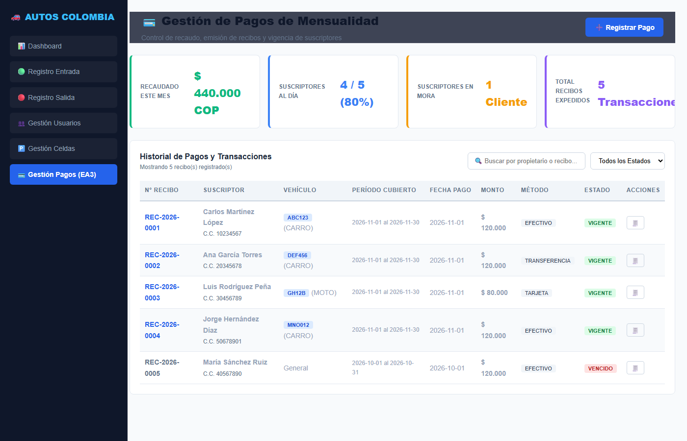

> **Análisis de UX/UI:** Las tarjetas de métricas superiores (KPIs) utilizan codificación cromática semántica: Verde (#10b981) para dinero recaudado, Azul (#3b82f6) para suscriptores al día, Ámbar (#f59e0b) para alertas de morosidad y Púrpura (#8b5cf6) para histórico total. La tabla cuenta con filtros dinámicos instantáneos sin recarga de página.

---

### Mockup 2: Formulario Modal de Registro de Pago de Mensualidad (HU-PAG-01)
Formulario reactivo donde el cajero selecciona el suscriptor; el sistema detecta de inmediato sus vehículos y tarifa oficial asociada, permitiendo seleccionar el mes, medio de pago y calculando los vueltos en efectivo de manera automática.

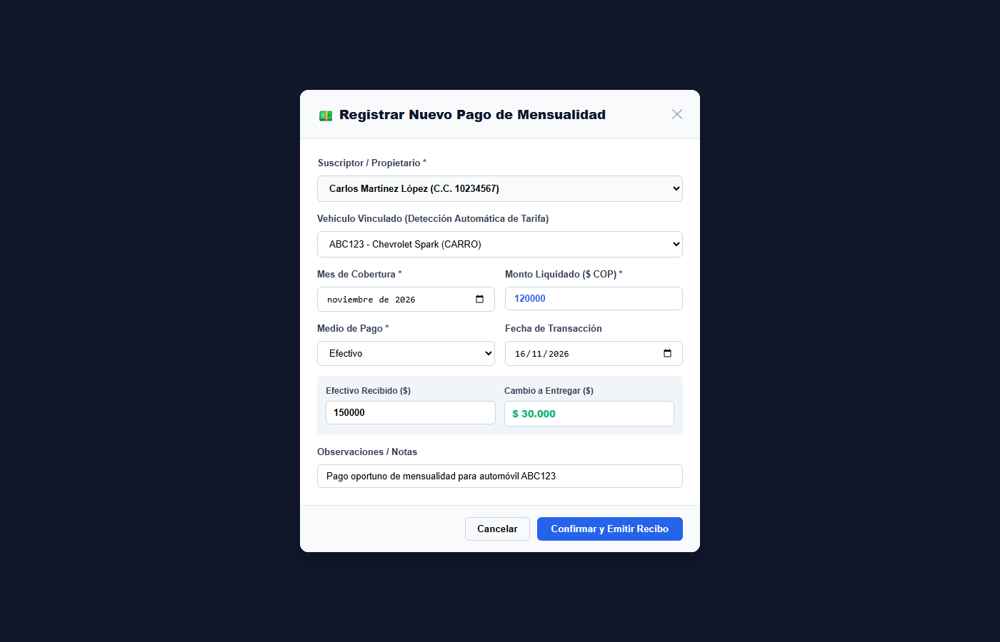

> **Análisis de UX/UI:** Reduce la fatiga y probabilidad de error humano del cajero al prellenar el valor exacto según la categoría vehicular (ej: $120.000 para Carro). El campo reactivo de vuelto asiste en operaciones de taquilla rápida.

---

### Mockup 3: Comprobante y Recibo de Pago Digital Oficial (HU-PAG-02)
Modal con el tiquete digital oficial con membrete corporativo, consecutivo legal `REC-2026-XXXX`, desglose de vigencia, medio de pago, código de barras/QR simulado y botón de impresión térmica para impresora POS de 80 mm.

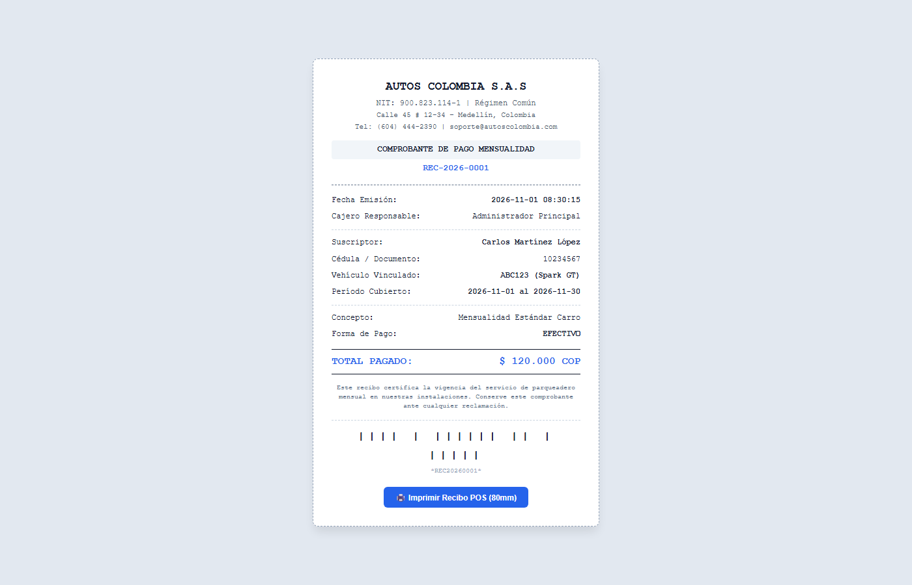

> **Análisis de UX/UI:** Tipografía monoespaciada para emular recibos fiscales estandarizados. Dispone de un botón directo de impresión térmica que invoca el diálogo de impresión del navegador formateado para tickets.

---

### Mockup 4: Control de Cartera y Suscriptores Morosos (HU-PAG-04)
Panel dedicado de cobranza que consolida en tiempo real todos los clientes que presentan mensualidad vencida, facilitando datos de contacto y un botón de cobro directo en un solo clic.

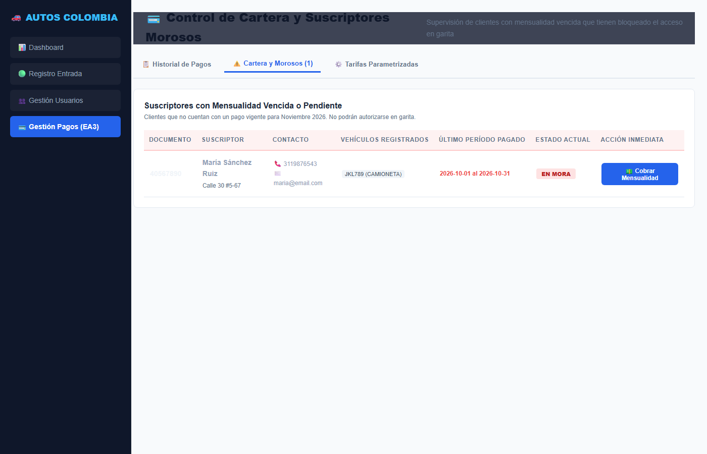

> **Análisis de UX/UI:** Facilita la labor de cobranza administrativa al exponer claramente el teléfono, correo y último mes cancelado, reduciendo los tiempos de gestión de cobro mediante el botón directo "💵 Cobrar Mensualidad".

---

### Mockup 5: Matriz de Tarifas Parametrizadas (HU-PAG-01, RF-PAG-02)
Vista de configuración donde se exponen las tarifas oficiales vigentes por categoría vehicular autorizadas por la administración del parqueadero.

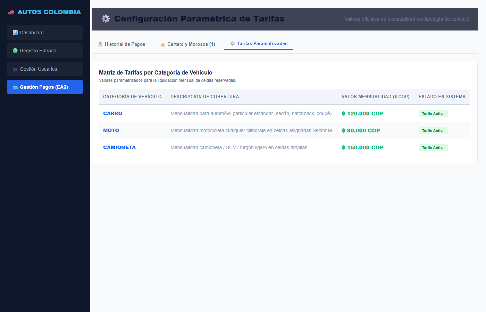

> **Análisis de UX/UI:** Claridad y transparencia en los valores mensuales: Automóviles particulares ($120.000 COP), Motocicletas ($80.000 COP) y Camionetas / SUVs ($150.000 COP).

---

## 4. DIAGRAMAS DE CASOS DE USO EN STARUML

El modelado de Casos de Uso fue concebido bajo el estándar **UML 2.5** en la herramienta **StarUML**, delimitando los límites del sistema, los actores involucrados y las dependencias estereotipadas `«include»` y `«extend»`.

### 4.1 Diagrama de Casos de Uso – Módulo de Gestión de Pagos (Iteración 3)

Representa las interacciones entre los actores `Administrador`, `Operador / Cajero`, `Motor del Sistema` y `Suscriptor / Cliente` en el ciclo de facturación y cartera.

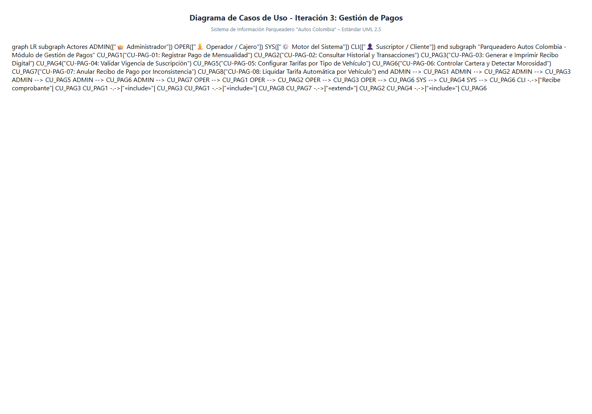

#### Matriz de Casos de Uso del Subsistema de Pagos
| Código CU | Nombre del Caso de Uso | Actores Primarios | Descripción y Relaciones |
| :--- | :--- | :--- | :--- |
| **CU-PAG-01** | Registrar Pago de Mensualidad | Operador / Cajero, Administrador | Registra el pago mensual de un cliente. `«include»` CU-PAG-03 (Generar Recibo) y `«include»` CU-PAG-08 (Liquidar Tarifa). |
| **CU-PAG-02** | Consultar Historial y Transacciones | Cajero, Administrador | Permite buscar y auditar pagos con filtros multicriterio. |
| **CU-PAG-03** | Generar e Imprimir Recibo Digital | Cajero, Cliente Suscriptor | Construye el tiquete oficial con consecutivo para entrega al cliente. |
| **CU-PAG-04** | Validar Vigencia de Suscripción en Garita | Motor del Sistema, Operador Garita | Verifica de forma automática si el vehículo entrante tiene el pago al día. |
| **CU-PAG-05** | Configurar Tarifas de Mensualidad | Administrador | Parametriza los costos mensuales para Carro, Moto y Camioneta. |
| **CU-PAG-06** | Controlar Cartera y Detectar Morosidad | Cajero, Administrador, Sistema | Monitorea clientes vencidos para gestión de cobranza y bloqueo en garita. |
| **CU-PAG-07** | Anular Recibo de Pago por Inconsistencia | Administrador | `«extend»` CU-PAG-02. Anulación justificada de transacciones erradas. |
| **CU-PAG-08** | Liquidar Tarifa Automática por Vehículo | Motor del Sistema | Determina el monto exacto según el tipo de vehículo seleccionado. |

---

### 4.2 Diagrama de Casos de Uso Global (Iteraciones 1, 2 y 3 Integradas)

Ofrece una visión holística de todo el software "Autos Colombia", evidenciando cómo el módulo de pagos de la Iteración 3 gobierna y condiciona el módulo de entradas/salidas de la Iteración 1, apoyándose en la base de datos de usuarios y celdas de la Iteración 2.

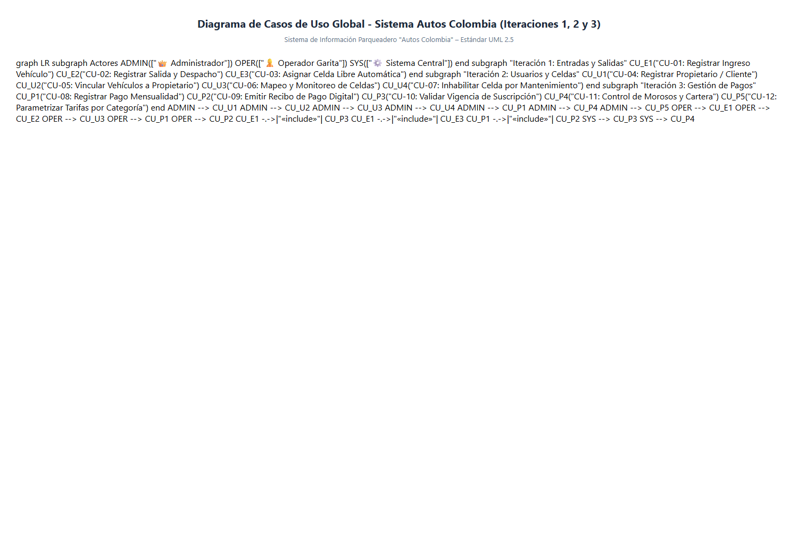

---

## 5. DIAGRAMAS DE SECUENCIA EN STARUML (ITERACIONES 1, 2 Y 3)

Se presenta la actualización completa de los Diagramas de Secuencia, garantizando la cobertura de los flujos críticos de las 3 iteraciones del proyecto bajo el estándar UML 2.5 en StarUML.

---

### Secuencia 1: Registrar Entrada de Vehículo (Iteración 1)
Describe la captura de placa en la garita, la verificación síncrona del pago de mensualidad (Iteración 3), la asignación algorítmica de celda y el registro del movimiento.

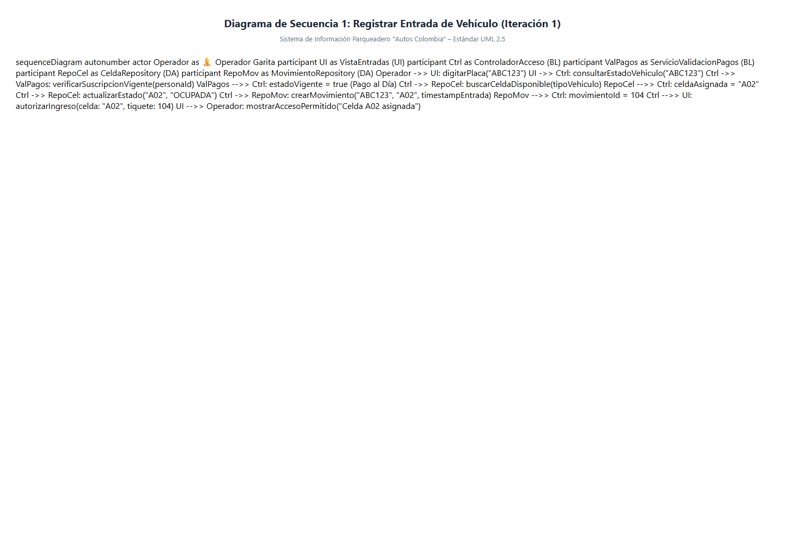

*Flujo:*  
1. El operador digita la placa en la interfaz de garita.  
2. El controlador consulta al servicio de validación de pagos si el cliente tiene mensualidad vigente.  
3. Al recibir confirmación positiva (`Al Día`), busca una celda libre compatible en el repositorio.  
4. Actualiza la celda a `OCUPADA` y crea el registro de movimiento con la hora de ingreso.  
5. Se muestra en pantalla la confirmación y la celda asignada al conductor.

---

### Secuencia 2: Registrar Salida de Vehículo (Iteración 1)
Describe la consulta de estancia activa, liquidación de tiempo y liberación atómica de la celda de parqueo.

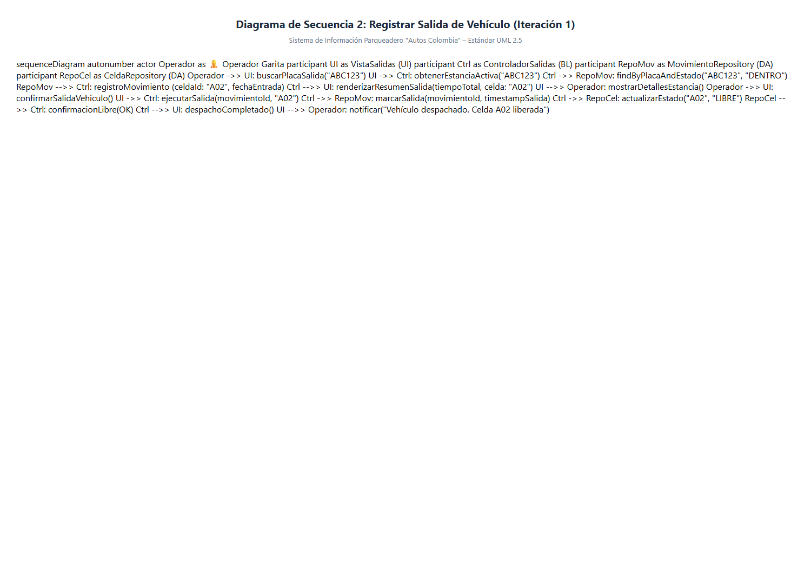

*Flujo:*  
1. El operador ingresa la placa que se dispone a salir.  
2. El sistema recupera el registro de movimiento activo con estado `DENTRO`.  
3. Se calcula el tiempo total de permanencia y se solicita confirmación de salida.  
4. El sistema marca la fecha y hora de salida en el movimiento y actualiza la celda a estado `LIBRE`.  
5. Se notifica la liberación exitosa del espacio en el mapa del parqueadero.

---

### Secuencia 3: Gestión de Usuarios y Vinculación de Vehículos (Iteración 2)
Describe el alta formal de un nuevo cliente suscriptor, la validación estricta de documentos y la vinculación de sus vehículos.

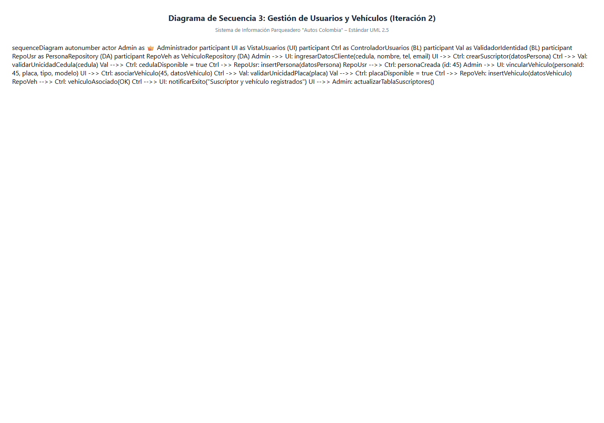

*Flujo:*  
1. El Administrador digita los datos del cliente (Cédula, Nombres, Teléfono, Correo).  
2. El validador comprueba que la cédula no esté previamente registrada.  
3. Se persiste la persona y se abre la vinculación vehicular capturando placa, tipo y modelo.  
4. El sistema valida la unicidad de la placa y asocia el vehículo al propietario.

---

### Secuencia 4: Mantenimiento e Inhabilitación de Celdas (Iteración 2)
Describe el bloqueo temporal de una celda para labores de reparación física, previniendo asignaciones accidentales.

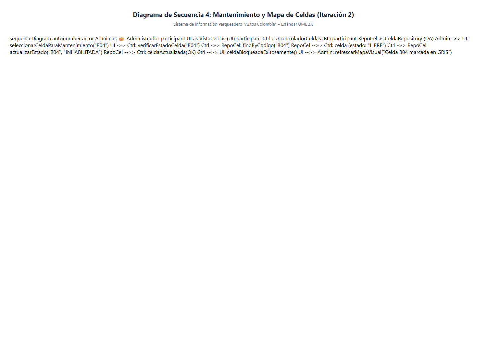

*Flujo:*  
1. El Administrador selecciona una celda en el mapa del parqueadero.  
2. El sistema valida que la celda se encuentre en estado `LIBRE` (no puede inhabilitarse si hay un vehículo dentro).  
3. Se actualiza el estado a `INHABILITADA` y se desactiva en el repositorio.  
4. El mapa interactivo cambia de forma reactiva el color de la celda a gris.

---

### Secuencia 5: Registro de Pago de Mensualidad y Emisión de Recibo (Iteración 3)
Describe el núcleo financiero del sistema: selección de suscriptor, autocompletado de tarifa, persistencia de pago, reactivación de cliente y construcción del comprobante digital.

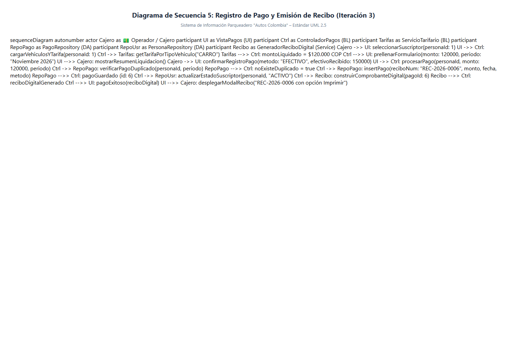

*Flujo:*  
1. El cajero selecciona al suscriptor en el formulario de pago.  
2. El servicio tarifario consulta el tipo de vehículo y suministra el valor oficial correspondiente.  
3. El cajero ingresa el mes de cobertura, método de pago y monto recibido.  
4. El repositorio valida que no exista un pago previo en el mismo mes y almacena el nuevo registro asignando el consecutivo oficial `REC-2026-XXXX`.  
5. Si el cliente estaba en mora/suspendido, se actualiza a estado `ACTIVO`.  
6. El servicio generador de recibos construye el comprobante digital y lo despliega en modal con opción de impresión directa.

---

### Secuencia 6: Validación de Pago al Ingreso en Garita (Iteraciones 1 y 3)
Describe la regla de negocio crítica que conecta la gestión de pagos con la seguridad física de garita mediante una bifurcación lógica estricta.

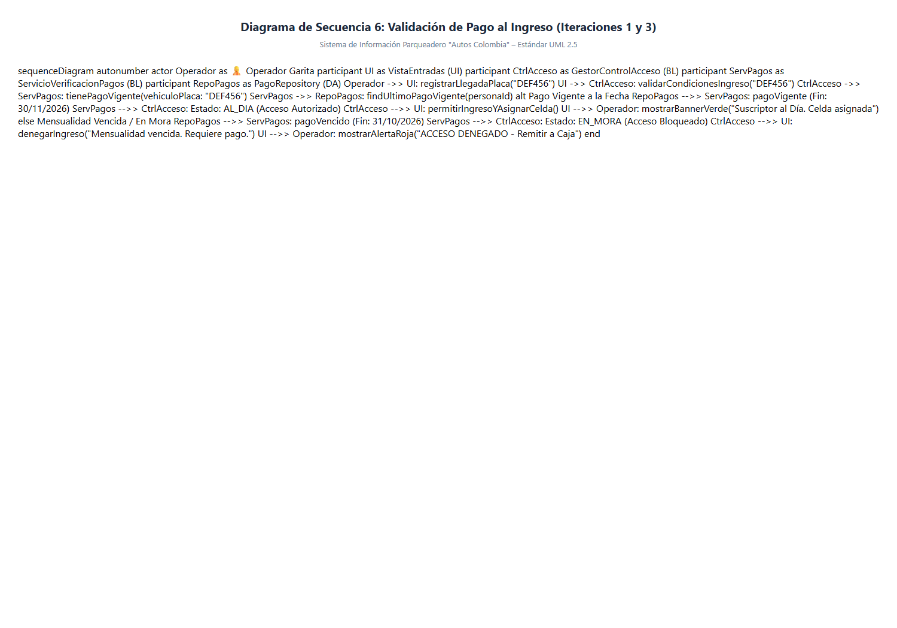

*Flujo:*  
1. El operador ingresa la placa del vehículo al llegar a la garita.  
2. El gestor de control de acceso delega la verificación al servicio de pagos.  
3. **Rama A (Pago Vigente):** El sistema confirma que el período cubre la fecha actual, autoriza el ingreso y asigna celda.  
4. **Rama B (Mensualidad Vencida / En Mora):** El sistema detecta ausencia de pago vigente, bloquea el botón de acceso y despliega una alerta roja indicando: "ACCESO DENEGADO - Remitir suscriptor a caja para cancelación de mensualidad".

---

## 6. DIAGRAMA DE COMPONENTES EN STARUML (ITERACIONES 1, 2 Y 3)

El **Diagrama de Componentes** modela la arquitectura de software modular del sistema "Autos Colombia", estructurada bajo el patrón de diseño en tres capas (**Layered Architecture**): Capa de Presentación (UI), Capa de Negocio (Business Layer), Capa de Acceso a Datos (DAL / Persistence) e interfaces con periféricos externos.

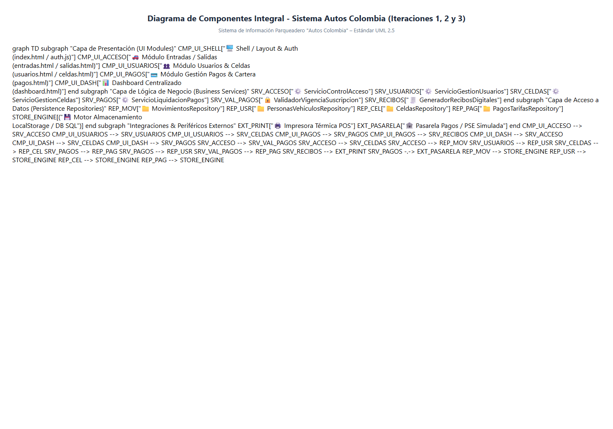

### Descripción de los Componentes Arquitectónicos

#### 1. Capa de Presentación (Frontend / UI Modules)
- **`CMP_UI_SHELL`:** Módulo contenedor principal que gestiona la autenticación de usuarios del sistema (`auth.js`), control de sesión, barra superior con reloj sincronizado y navegación entre vistas.
- **`CMP_UI_ACCESO`:** Módulo de garita compuesto por `entradas.html` y `salidas.html`, encargado de capturar placas y guiar al operador en el despacho de vehículos.
- **`CMP_UI_USUARIOS`:** Módulo administrativo en `usuarios.html` y `celdas.html` para la administración de clientes, vehículos y mapa de infraestructura física.
- **`CMP_UI_PAGOS`:** Módulo financiero en `pagos.html` que agrupa el historial de recibos, la pestaña de cartera/morosos, el modal de cobro y la vista de impresión de tiquetes.
- **`CMP_UI_DASH`:** Tablero de control consolidado en `dashboard.html` que monitorea en tiempo real los KPIs de ocupación y salud financiera del parqueadero.

#### 2. Capa de Lógica de Negocio (Business Layer / Application Services)
- **`SRV_ACCESO`:** Orquesta el flujo de ingreso y egreso, aplicando validaciones de permanencia y coordinando la asignación de espacios.
- **`SRV_USUARIOS`:** Implementa reglas de negocio sobre usuarios: unicidad de cédulas, integridad de correos y validación de placas únicas.
- **`SRV_CELDAS`:** Algoritmo de asignación inteligente de espacios según el tipo de vehículo (Carro vs Moto) y control de mantenimiento físico.
- **`SRV_PAGOS`:** Motor transaccional de caja: liquidación de valores, prevención de pagos duplicados y anulación controlada con auditoría.
- **`SRV_VAL_PAGOS`:** Regla de negocio transversal que conecta la capa de pagos con la garita para autorizar o denegar accesos en tiempo real.
- **`SRV_RECIBOS`:** Generador de documentos digitales que formatea tiquetes bajo estándar POS térmico con códigos de barras.

#### 3. Capa de Acceso a Datos (Data Access Layer / Persistence Repositories)
- **`REP_MOV` (`MovimientosRepository`):** Persistencia de registros de entradas, salidas y tiempos de estancia.
- **`REP_USR` (`PersonasVehiculosRepository`):** Persistencia relacional de clientes y parque vehicular vinculado.
- **`REP_CEL` (`CeldasRepository`):** Control del estado de los 50 espacios físicos de parqueo.
- **`REP_PAG` (`PagosTarifasRepository`):** Almacenamiento seguro de transacciones de pago, consecutivo de recibos y tarifas parametrizadas.
- **`STORE_ENGINE`:** Motor de persistencia subyacente que opera sobre `localStorage` en el cliente web y esquema relacional normalizado en `MySQL / MariaDB`.

#### 4. Integraciones y Periféricos Externos
- **`EXT_PRINT`:** Conexión con impresoras térmicas de recibos de 80 mm para entrega física de comprobantes.
- **`EXT_PASARELA`:** Módulo de comunicación preparado para integración con pasarelas de pago electrónico (PSE / Datáfono bancario).

---

## 7. FORMATO DE PLAN DE PRUEBAS RESUMIDO (GESTIÓN DE PAGOS)

A continuación se presenta el **Plan de Pruebas Resumido** debidamente diligenciado para el módulo de Gestión de Pagos, formulado bajo las directrices de aseguramiento de calidad de software **ISTQB / IEEE 829**. Se ejecutaron 10 casos de prueba rigurosos que abarcan pruebas funcionales, validaciones de reglas de negocio, pruebas de seguridad e integración transaccional.

| ID Caso de Prueba | Historia Asociada | Funcionalidad a Probar | Precondiciones | Datos de Entrada | Pasos de Ejecución | Resultado Esperado | Resultado Obtenido | Estado | Severidad |
| :--- | :--- | :--- | :--- | :--- | :--- | :--- | :--- | :--- | :--- |
| **CP-PAG-01** | `HU-PAG-01` | Registro exitoso de pago de mensualidad en efectivo | Suscriptor "Carlos Martínez" registrado y sin pago en Noviembre. | Cliente: Carlos Martínez, Mes: 2026-11, Monto: $120.000, Medio: Efectivo, Recibido: $150.000. | 1. Abrir modal "Registrar Pago".<br>2. Seleccionar cliente y mes.<br>3. Ingresar efectivo recibido.<br>4. Clic en "Confirmar y Emitir Recibo". | Pago registrado con consecutivo secuencial. Cambio calculado en $30.000. Estado `VIGENTE`. | El sistema guardó el pago con recibo REC-2026-0006, calculó cambio de $30.000 y abrió el recibo. | PASÓ | Crítica |
| **CP-PAG-02** | `HU-PAG-01` | Autocompletado de tarifa según tipología de vehículo | Suscriptor con motocicleta registrada en el sistema. | Cliente: Luis Rodríguez, Vehículo: Moto Honda CB125F (GH12B). | 1. Abrir modal de pago.<br>2. Seleccionar suscriptor "Luis Rodríguez".<br>3. Observar campo de monto liquidado. | El sistema detecta tipo `MOTO` y preselecciona tarifa de $80.000 COP automáticamente. | El campo monto se fijó inmediatamente en 80000 COP sin intervención manual. | PASÓ | Alta |
| **CP-PAG-03** | `HU-PAG-01` | Bloqueo de pago duplicado en el mismo período | Suscriptor ya cuenta con un pago vigente para Noviembre 2026. | Cliente: Carlos Martínez, Mes: 2026-11, Monto: $120.000. | 1. Intentar registrar un nuevo pago para el mismo cliente en 2026-11.<br>2. Clic en confirmar. | El sistema rechaza la transacción con mensaje de error por duplicidad de período. | Se desplegó alerta roja: "Ya existe un pago registrado para este propietario en el mismo período". | PASÓ | Alta |
| **CP-PAG-04** | `HU-PAG-01` | Reactivación automática de suscriptor suspendido por mora | Suscriptor "María Sánchez" en estado `SUSPENDIDO`. | Cliente: María Sánchez, Mes: 2026-11, Monto: $120.000, Medio: Transferencia. | 1. Registrar pago de mensualidad a nombre de María Sánchez.<br>2. Verificar estado en tabla de usuarios. | Al guardar el pago, el estado del cliente debe cambiar automáticamente de `SUSPENDIDO` a `ACTIVO`. | El estado del cliente en la base de datos y en la tabla cambió automáticamente a `ACTIVO`. | PASÓ | Alta |
| **CP-PAG-05** | `HU-PAG-02` | Generación y despliegue del recibo digital oficial | Pago recién confirmado en el sistema. | Identificador del nuevo pago generado. | 1. Culminar guardado de pago.<br>2. Verificar modal emergente de recibo. | Apertura modal con membrete "Autos Colombia", NIT, consecutivo, desglose y botón de impresión. | Se desplegó modal con tiquete formateado, datos exactos del cliente y código de barras. | PASÓ | Media |
| **CP-PAG-06** | `HU-PAG-03` | Autorización de acceso en garita por pago vigente | Vehículo ABC123 con mensualidad vigente en Noviembre. | Placa: `ABC123` en vista de entradas. | 1. Ir a `entradas.html`.<br>2. Digitar placa "ABC123".<br>3. Presionar botón "Buscar". | El sistema marca mensualidad "Al Día" en verde y permite confirmar el ingreso vehicular. | Etiqueta verde "Al Día" mostrada. Celda asignada automáticamente y botón de entrada habilitado. | PASÓ | Crítica |
| **CP-PAG-07** | `HU-PAG-03` | Denegación de acceso en garita por mensualidad vencida | Suscriptor con pago vencido el mes anterior. | Placa: `JKL789` en vista de entradas. | 1. Ir a `entradas.html`.<br>2. Digitar placa del suscriptor en mora.<br>3. Presionar botón "Buscar". | El sistema marca mensualidad "En Mora" en rojo y bloquea el botón de confirmación de entrada. | Se mostró badge rojo "En Mora / Vencido", botón bloqueado y mensaje de remitir a caja. | PASÓ | Crítica |
| **CP-PAG-08** | `HU-PAG-04` | Visualización en tiempo real de cartera de morosos | Existen clientes sin pago registrado para el mes actual. | Navegación a pestaña "⚠️ Cartera y Morosos". | 1. En `pagos.html`, hacer clic en pestaña "Cartera y Morosos".<br>2. Verificar contenido de tabla y contador. | Listado detallado de morosos con teléfono, email, último pago y botón de cobro rápido. | Contador reflejó morosos activos. La tabla mostró los datos de contacto y botón de cobro directo. | PASÓ | Media |
| **CP-PAG-09** | `HU-PAG-05` | Anulación justificada de recibo de pago con auditoría | Recibo registrado previamente en el sistema. | Clic en botón "✕" de fila de pago. Motivo: "Error en digitación de placa". | 1. Clic en anular recibo.<br>2. Ingresar motivo en el prompt.<br>3. Confirmar acción. | Estado cambia a `ANULADO`, texto tachado, registro conservado con motivo y fecha. | El pago cambió a badge `ANULADO`, conservó su historial y se deshabilitó su botón de anulación. | PASÓ | Media |
| **CP-PAG-10** | `HU-PAG-06` | Búsqueda reactiva por texto en historial de pagos | Múltiples pagos registrados en la base de datos. | Término de búsqueda: "REC-2026-0001". | 1. Digitar "REC-2026-0001" en la caja de búsqueda rápida.<br>2. Observar filtrado reactivo de la tabla. | La tabla se reduce inmediatamente a mostrar únicamente la fila del recibo buscado. | Filtrado en tiempo real sin recarga de página mostrando únicamente el registro correspondiente. | PASÓ | Baja |

---

## 8. ENLACE AL REPOSITORIO DE GITHUB Y ACTUALIZACIÓN DE CÓDIGO FUENTE

El código fuente del sistema de información para el parqueadero **"Autos Colombia"** se encuentra versionado y gestionado bajo buenas prácticas de desarrollo colaborativo en la plataforma **GitHub**, incorporando la totalidad de los módulos implementados a lo largo de las 3 iteraciones del proyecto.

### 8.1 URL Oficial del Repositorio
- **Enlace del Repositorio en GitHub:**  
  [https://github.com/marianomolina-cloud/taller-3-Dise-o-Sistema-de-Informaci-n-Iteraci-n-3.git](https://github.com/marianomolina-cloud/taller-3-Dise-o-Sistema-de-Informaci-n-Iteraci-n-3.git)  
  *(Repositorio oficial de Mariano Molina Monsalve – Evidencia de Aprendizaje 3: Módulo de Gestión de Pagos, Recibos Digitales, Tarifas Parametrizadas, Control de Cartera y Diagramas UML 2.5 de las 3 Iteraciones)*.

### 8.2 Estructura del Proyecto en el Repositorio
```text
Parqueadero Diseño Sistema de Información - 3/
├── docs/
│   ├── diagramas/              # Diagramas UML exportados en alta resolución (PNG)
│   │   ├── diagrama_casos_de_uso_pagos.png
│   │   ├── diagrama_casos_de_uso.png
│   │   ├── secuencia_1_entrada_vehiculo.png
│   │   ├── secuencia_2_salida_vehiculo.png
│   │   ├── secuencia_3_gestion_usuarios.png
│   │   ├── secuencia_4_mantenimiento_celdas.png
│   │   ├── secuencia_5_registro_pago.png
│   │   ├── secuencia_6_validacion_acceso_pago.png
│   │   └── diagrama_componentes.png
│   ├── mockups/                # Prototipos de interfaz de usuario capturados (PNG)
│   │   ├── 8_gestion_pagos.png
│   │   ├── 9_registro_pago.png
│   │   ├── 10_recibo_digital.png
│   │   ├── 11_cartera_morosos.png
│   │   └── 12_tarifas_mensualidad.png
│   ├── staruml/                # Proyecto nativo StarUML
│   │   └── AutosColombia_Iteracion3.mdj
│   ├── diagramas_uml.md        # Especificación técnica formal de diagramas UML
│   ├── historias_usuario.md    # Historias de usuario con sintaxis Gherkin / BDD
│   ├── modelo_fisico.sql       # Script DDL SQL normalizado en MySQL / MariaDB
│   └── requisitos.md           # Matriz formal de RF y RNF
├── src/                        # Código fuente del sistema web funcional
│   ├── css/
│   │   └── main.css            # Estilos corporativos, componentes y diseño responsivo
│   ├── js/
│   │   ├── auth.js             # Módulo de sesión, control de roles y layout
│   │   └── db.js               # Motor de persistencia transaccional (localStorage)
│   ├── celdas.html             # Mapa interactivo y gestión de infraestructura
│   ├── dashboard.html          # Panel central con indicadores de ocupación y caja
│   ├── entradas.html           # Registro de ingresos con validación de pagos en garita
│   ├── historial.html          # Historial general de movimientos vehiculares
│   ├── index.html              # Autenticación y acceso al sistema
│   ├── novedades.html          # Bitácora de incidentes u observaciones sobre vehículos
│   ├── pagos.html              # Módulo completo de Gestión de Pagos e Impresión de Recibos
│   ├── salidas.html            # Registro de salidas y despacho vehicular
│   ├── usuarios.html           # Gestión de clientes propietarios
│   └── vehiculos.html          # Gestión del parque automotor suscrito
├── scripts/                    # Scripts de automatización en Node.js
│   ├── build_html_and_pdf.js   # Compilador editorial de Markdown a HTML y PDF
│   ├── capture_screenshots_ea3.js # Generador de capturas de mockups vía Chrome Headless
│   ├── generate_staruml.js     # Generador automatizado de modelos StarUML (.mdj)
│   └── render_diagrams_to_png.js # Renderizador de diagramas Mermaid a PNG
├── Molina_Mariano_EA3.pdf      # Documento técnico oficial de entrega
└── README.md                   # Documentación general y guía de instalación
```

---

# CONCLUSIONES

1. **Consolidación Metodológica mediante Desarrollo Iterativo e Incremental:**  
   La ejecución secuencial de las tres iteraciones bajo el marco de la Ingeniería de Software demostró ser altamente efectiva para descomponer un problema empresarial complejo en entregables manejables, verificables y de valor tangible. Iniciar con el flujo operacional en garita (Iteración 1), profundizar en la administración de usuarios y celdas (Iteración 2) y culminar con el subsistema de pagos y control financiero (Iteración 3) aseguró que cada componente arquitectónico se construyera sobre cimientos previamente probados, eliminando reprocesos y reduciendo el riesgo de integración a cero.

2. **Impacto de la Gestión de Pagos en la Sostenibilidad y Control Operativo:**  
   La automatización de la recaudación mediante tarifas diferenciadas por tipología vehicular (Carro, Moto, Camioneta) y la emisión de comprobantes oficiales con numeración secuencial (`REC-YYYY-XXXX`) profesionaliza radicalmente la operación del parqueadero "Autos Colombia". Más importante aún, la interconexión síncrona entre el estado financiero del suscriptor y la garita de acceso resuelve el problema crítico de la cartera vencida, impidiendo automáticamente el ingreso a clientes en mora y garantizando que solo los usuarios al día disfruten del servicio.

3. **Rigor del Modelado UML 2.5 en StarUML y Arquitectura en Tres Capas:**  
   El uso estandarizado de diagramas de casos de uso, diagramas de componentes y diagramas de secuencia exhaustivos permitió mapear con absoluta fidelidad las interacciones entre actores, servicios de negocio y repositorios de datos. La arquitectura en capas implementada garantiza el principio de responsabilidad única (SRP), facilitando que el motor de almacenamiento pueda migrar fluidamente desde una capa local en el navegador hacia una base de datos relacional robusta (MySQL / PostgreSQL) mediante los scripts SQL normalizados suministrados.

4. **Aseguramiento de Calidad mediante Planes de Prueba Rigurosos:**  
   El diseño y diligenciamiento del plan de pruebas resumido bajo lineamientos ISTQB/IEEE 829 validó no solo los caminos felices del sistema (registro exitoso de pago, generación de recibos, acceso permitido), sino de forma prioritaria los escenarios de borde y contingencia: bloqueo de pagos duplicados para un mismo mes, denegación inmediata en garita para suscriptores vencidos, reactivación automática de clientes suspendidos tras el cobro y anulación justificada de recibos con estricta trazabilidad de auditoría.
