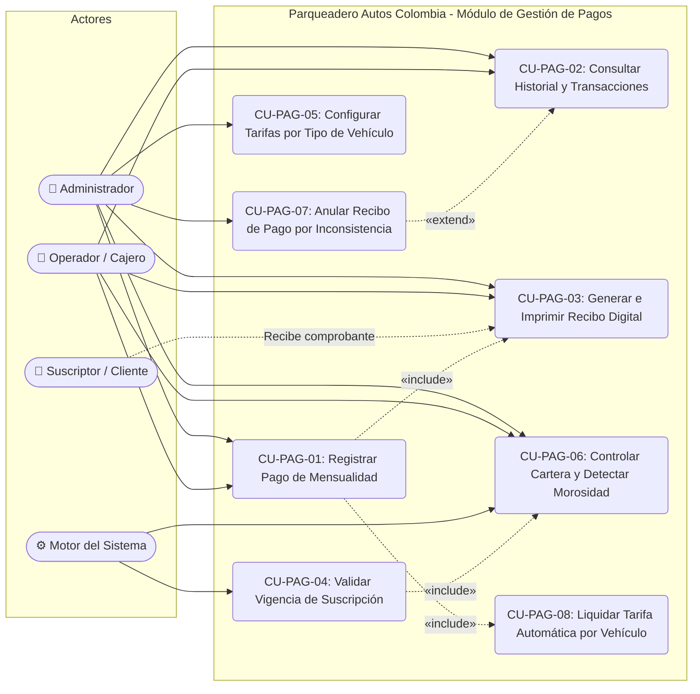
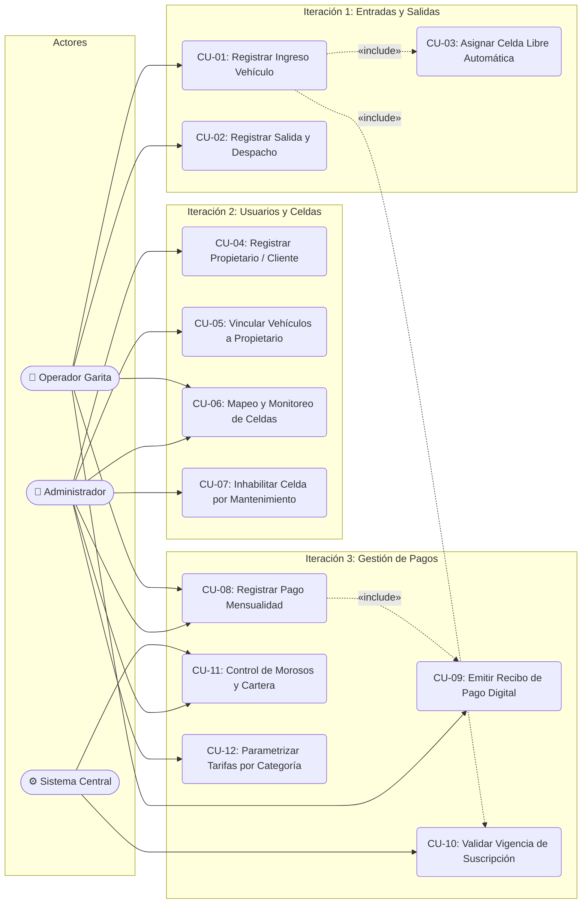
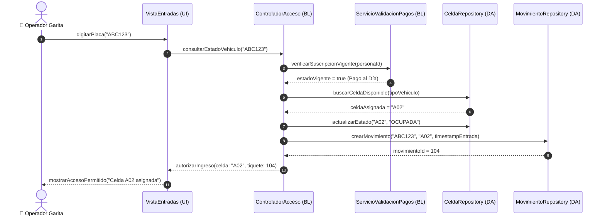
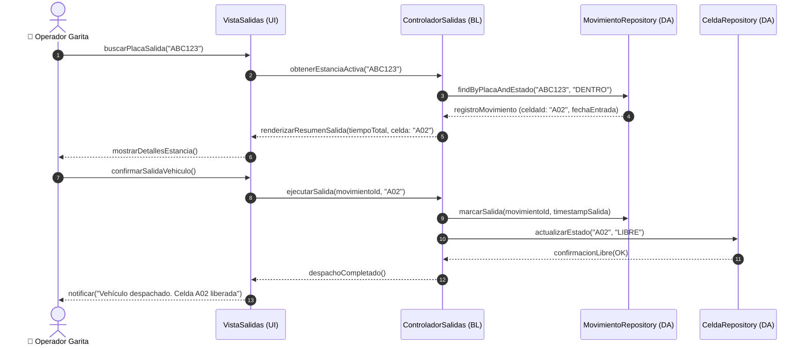
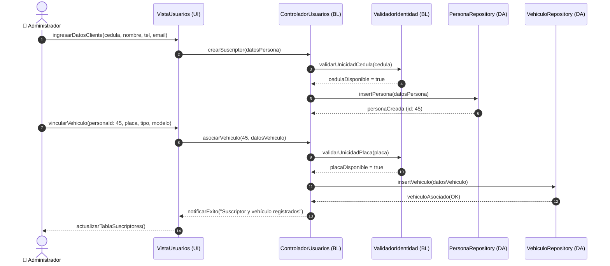
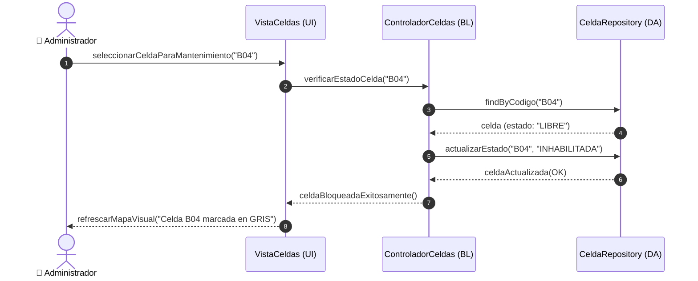
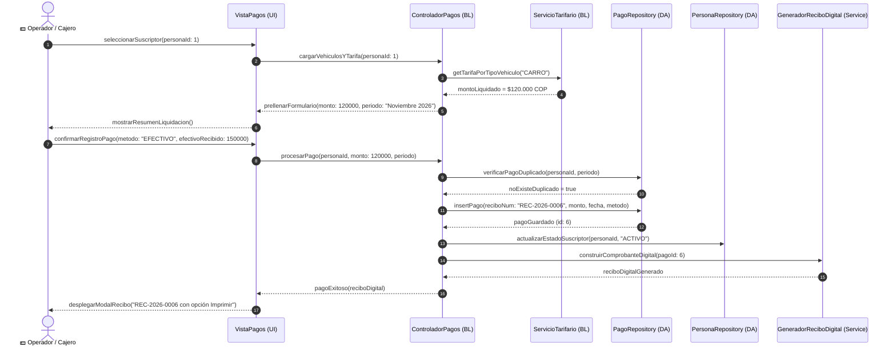
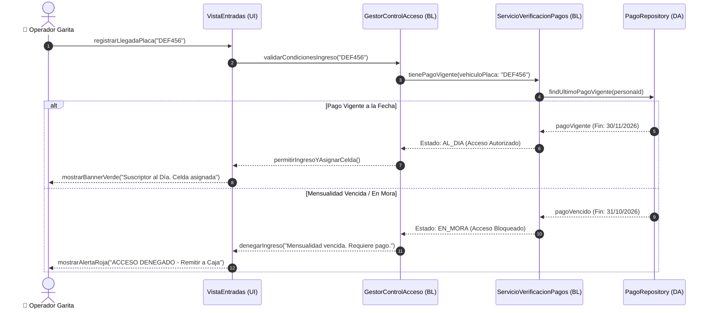
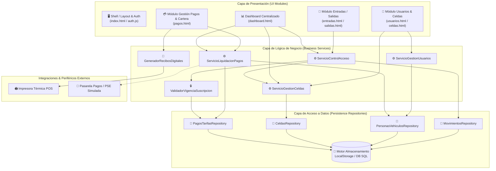

# Diagramas UML – Parqueadero "Autos Colombia"
## Iteración 3: Gestión de Pagos y Consolidación de las 3 Iteraciones
### Estándar UML 2.5 – Modelado en StarUML

---

## 1. Diagrama de Casos de Uso – Subsistema de Gestión de Pagos

El subsistema de pagos administra las transacciones de mensualidades, la emisión de recibos oficiales, la validación de derechos de acceso para los suscriptores y la parametrización de tarifas.

---

## 2. Diagrama de Casos de Uso Global (Iteraciones 1, 2 y 3)

Muestra la articulación completa entre la operación en garita (entradas/salidas), la gestión administrativa de personas y celdas, y la gestión financiera de mensualidades.

---

## 3. Diagramas de Secuencia (Iteraciones 1, 2 y 3)

### Secuencia 1: Registrar Entrada de Vehículo (Iteración 1)
Describe la interacción cuando un vehículo ingresa al parqueadero, verificando pago y asignando celda.

### Secuencia 2: Registrar Salida de Vehículo (Iteración 1)
Describe el egreso del vehículo, cálculo de tiempo de estancia y liberación atómica del espacio.

### Secuencia 3: Gestión de Usuarios y Vehículos (Iteración 2)
Describe el alta de un nuevo cliente, validación estricta de documentos y vinculación de vehículo.

### Secuencia 4: Mantenimiento y Mapa de Celdas (Iteración 2)
Describe la inhabilitación preventiva de un espacio de parqueo para reparaciones.

### Secuencia 5: Registro de Pago y Emisión de Recibo (Iteración 3)
Describe el cobro de la mensualidad, asignación de tarifa según el vehículo y expedición del comprobante oficial.

### Secuencia 6: Validación de Pago al Ingreso (Iteración 3 y 1)
Describe la bifurcación lógica según el estado de la mensualidad al arribar al parqueadero.

---

## 4. Diagrama de Componentes Integral (Iteraciones 1, 2 y 3)

Ilustra la estructura modular desacoplada del sistema agrupada en Capa de Presentación, Capa de Negocio, Capa de Persistencia e Integraciones con periféricos.

